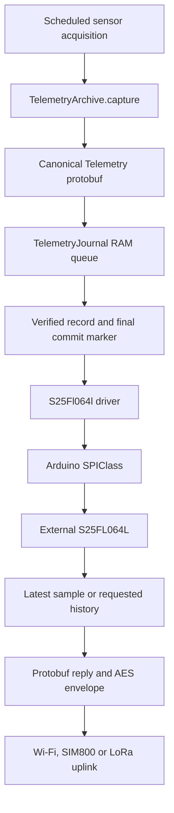

# WIOT STM32 SPI flash interface and telemetry storage

Version 1.0 • 18 November 2026 • Arduino STM32 release

## Hardware and interface

The installed device is an Infineon/Cypress S25FL064L serial NOR flash. Its expected three-byte JEDEC identification is `01 60 17`. Capacity is 64 Mbit, which is 8,388,608 bytes or 8 MiB. This is external storage connected to the STM32 SPI1 pins.

| Signal | STM32 pin | Flash function |
|---|---|---|
| CS# | PA4 | Active-low chip select |
| SCK | PA5 | Clock |
| MISO | PA6 | SO/IO1 |
| MOSI | PA7 | SI/IO0 |
| Supply | 3.3 V and common ground | VCC and VSS |

Use the verified bench wiring for WP#/IO2 and IO3/RESET# so those inputs have defined levels. The software uses ordinary single-bit SPI, mode 0, most-significant bit first. The release default is 4 MHz. The independent bench sketch used 1 MHz.

`APP_ENABLE_SPI_FLASH` enables the sensor-node archive. `APP_FLASH_SPI_HZ` selects its clock. `APP_FLASH_RETENTION_SECONDS` selects the generation retention period and defaults to `86400` seconds. Zero selects manual clearing. The allowed SPI clock configuration is 100 kHz through 12 MHz.

## Software ownership

`S25Fl064l` is the project's driver. It uses the STM32 Arduino `SPIClass` API. `NorFlash` defines its small interface so journal tests can replace the physical flash with a model in RAM. `TelemetryJournal` implements persistent record geometry, CRC checks, recovery, generations and retention. `TelemetryArchive` maps acquired application data into protobuf samples and implements the server commands and history transfer.

## SPI commands used by the production driver

| HEX opcode | Operation | Use in this project |
|---|---|---|
| `9F` | Read JEDEC ID | Identify the expected chip at startup |
| `05` | Read status register 1 | Check WIP/busy and write-enable latch |
| `07` | Read status register 2 | Check erase/program error bits |
| `06` | Write enable | Required before every program or sector erase |
| `13` | Read with four address bytes | Read a bounded byte range |
| `12` | Page program with four address bytes | Program within one 256-byte page |
| `21` | Sector erase with four address bytes | Erase one aligned 4,096-byte sector |
| `B9` | Deep power-down | Reduce flash consumption before controller sleep |
| `AB` | Release deep power-down | Wake the device, followed by 50 microseconds |

The explicit four-address-byte instructions keep access independent of the chip's current three/four-byte address-mode setting. SPI addresses are sent most-significant byte first. The record's own integer metadata uses little-endian storage.

An SPI transaction starts by pulling CS# low, sends the opcode and any address/data, and ends by raising CS#. Page programming accepts at most the bytes remaining in the current 256-byte page. Erase operates on a complete 4 KiB sector. Program changes bits from one to zero. Erase restores bits to one, giving erased bytes of `FF`.

The driver starts a program/erase and returns. Later foreground passes call `poll()` to check completion. Program timeout is 10 ms and sector erase timeout is 1,000 ms. These are the driver's configured fault deadlines. The application continues through cooperative state-machine steps while the flash is busy. A queue acceptance means the sample is in RAM until its final record commit is verified.

## Exact flash capacity and layout

| Allocation | Quantity | Bytes |
|---|---|---|
| Physical flash | 2,048 sectors | 8,388,608 |
| Alternating metadata sectors | 2 sectors | 8,192 |
| Data-sector area | 2,046 sectors | 8,380,416 |
| Reserved header region in each data sector | 512 bytes × 2,046 | 1,047,552 |
| Available record slots | 7 × 2,046 | 14,322 records |
| Total record-slot capacity | 14,322 × 512 bytes | 7,332,864 |
| Geometry overhead | Metadata sectors and data-sector header regions | 1,055,744 |

Metadata sector A occupies `0x000000–0x000FFF`. Metadata sector B occupies `0x001000–0x001FFF`. Data sectors occupy `0x002000–0x7FFFFF`. A data sector contains a 512-byte header region followed by seven 512-byte sample slots. Its valid sector header uses 28 bytes of the reserved header region.

Data sectors rotate between generations. Sequence-to-address mapping starts from the generation's rotated sector origin. A sequence identifies a physical slot within that generation. Interrupted writes can leave gaps.

## Exact bytes within each 512-byte sample slot

| Offset | Bytes | Meaning |
|---|---|---|
| 0 | 4 | Record magic `0x57524331` |
| 4 | 4 | Record format version, currently 1 |
| 8 | 4 | Generation-relative sequence number |
| 12 | 4 | Acquisition RTC epoch in seconds |
| 16 | 4 | Calendar day key, `YYYYMMDD` |
| 20 | 4 | Actual protobuf payload length |
| 24 | 8 | Reserved bytes |
| 32 | Up to 472 | Canonical Telemetry protobuf and unused `FF` padding |
| 504 | 4 | CRC32 over offsets 0 through 503 |
| 508 | 4 | Final commit marker `0x434D4954` |
| Total | **512** | **Fixed physical occupancy per sample** |

The payload is serialized protobuf. The flash journal stores this plaintext sample. AES wrapping occurs when the application sends an uplink or command reply.

The stored sample includes node/sensor identity, acquisition time, configured sampling/transmission periods, battery voltage, all enabled sensor readings and validity flags, flow-period and cumulative totals, valve command state, power state, and both reset counts. With both flow meters selected, the original flow fields contain TUF and the optional secondary reading contains Supmea. HNDA and Sondas have separate soil fields. Canonical samples exclude command acknowledgments, flash status metadata and history-transfer envelopes.

Protobuf size varies with selected sensors and values. Default zero scalar values are generally omitted. Integer sizes depend on their magnitude. A populated float uses four data bytes plus its field tag. The size of a C++ structure in RAM is a separate quantity from the encoded payload length.

The reproducible four-sensor example in `inspect_storage_sizes.py` encodes to **195 protobuf bytes** and occupies **512 flash bytes**. The AES envelope for that canonical protobuf would occupy **225 bytes**. A normal Status or history reply uses its own message fields and can have a different transmitted length.

The stored-payload limit is **472 bytes**. The generated maximum encoded sizes for complete messages are **333 bytes for Status_Message**, **546 bytes for Telemetry**, and **80 bytes for Gateway_Status**. The complete Telemetry maximum includes optional control/history/flash metadata. Storage uses the canonical sample subset and checks the 472-byte limit before accepting it.

For a protobuf of `N` bytes, the current network envelope occupies `17 + 16 × (floor(N / 16) + 1)` bytes. This accounts for one version byte, a 16-byte IV, and AES block padding. Maximum envelopes are 353 bytes for Status, 577 bytes for complete Telemetry, and 113 bytes for Gateway_Status. MQTT topics/headers and TCP/radio transport overhead are additional.

To reproduce the example, run `python Documentation/FlashStorage/inspect_storage_sizes.py`. In FULL debug output, `sample_append ... protobuf_bytes=...` gives the actual serialized sample length. `journal_update ... committed_records=...` confirms durable record progress.

## Capacity at different sampling intervals

| Sampling interval | Samples per 24 hours | Slot bytes per 24 hours | Capacity with automatic clearing disabled |
|---|---|---|---|
| 10 seconds | 8,640 | 4,423,680 | 39.78 hours |
| 20 seconds | 4,320 | 2,211,840 | 79.57 hours |
| 60 seconds | 1,440 | 737,280 | 9.95 days |
| 5 minutes | 288 | 147,456 | 49.73 days |
| 1 hour | 24 | 12,288 | 596.75 days |

These are nominal full-window calculations. The first sample boundary, recovery gaps, interrupted slots and reset behavior can affect the exact count. Automatic 24-hour clearing normally limits the retained dataset before physical capacity is reached. When full, the journal rejects new samples and counts drops until cleared.

`FLASH_STATUS.used_bytes` counts consumed record slots, including interrupted slots, multiplied by 512. `free_bytes` counts remaining record-slot capacity. It excludes the metadata sectors and sector-header reservations. `record_count` counts valid committed records. Consequently, occupied slots can exceed valid record count after an interrupted write.

## Acquisition, upload and integrity

1. At the sampling deadline, the node polls its enabled sensors and updates the current snapshot. Missing/invalid sensor readings have zero values with their validity flags cleared.
2. `capture()` requires a trusted RTC and an initialized, recovered, unexpired journal. It serializes a canonical sample and copies it into a queue with room for four samples.
3. Foreground `step()` calls allocate a sector if required, program the first 256 bytes, then program 252 bytes from the second page. The code reads those bytes back and compares them.
4. Only after verification does it program the last four bytes as the commit marker. It reads and validates the completed record before increasing the valid record count.
5. At a scheduled transmission, `storedStatus()` reads and decodes the latest committed sample. Current valve/reset/power fields are refreshed by the calling status builder. Acquisition timestamp and stored-sample provenance identify the retained measurements. The current implementation uploads a live fallback when a committed stored sample is unavailable, with an explicit fallback flag.
6. On reboot, the journal selects the newest valid metadata copy and scans records cooperatively. It accepts records with valid ownership, format, CRC and commit marker. A torn slot remains consumed and is skipped.

The 48-byte metadata record stores magic, version, revision, generation, retention start, capacity, rotated sector origin, node ID, clear request identity, sweep state, CRC and a final commit marker. Alternating metadata copies permit recovery if a write is interrupted.

Reset counters and selected persistent controller settings use the STM32's separate EEPROM emulation allocation. Their dedicated reset-counter clear commands are 7 and 8. External journal clearing operates on the telemetry generation.

CRC and commit markers detect incomplete or damaged records. The four-entry RAM queue can lose its uncommitted samples during power loss. Dropped-sample counters are runtime diagnostics, while committed record counts are rebuilt from flash at startup.

## Retention and clear behavior

The retained batch is a generation. Its start epoch is saved in flash. The expiry is `saved start epoch + APP_FLASH_RETENTION_SECONDS`. Power cycling preserves that start. The implementation uses trusted RTC epoch time for elapsed retention, so a large forward time correction can make the batch immediately expired. An untrusted RTC or a clock behind the saved start prevents retained-data use until time is corrected.

Clearing commits a new empty generation before reclaiming old sectors. The old records then leave the current dataset, and cooperative sector sweeping physically erases obsolete contents. `clear_sectors_remaining` indicates sweep progress. Programming and erasing continue in bounded foreground steps, and power management delays sleep when outstanding writes require progress.

Use `0` for manual clearing, `3600` for one hour, `86400` for one day, or `604800` for one week. Reflashing a different retention value applies it to the saved start epoch. If the new period has already expired, clearing can begin immediately once time is trusted.

## Server commands and commissioning

| Command | ID | Data | Behavior |
|---|---|---|---|
| CLEAR_FLASH | 9 | 0 | Accept an asynchronous generation change and erase sweep |
| FLASH_STATUS | 10 | 0 | Report geometry, state, used/free slots, counts, expiry and errors |
| FLASH_LAST | 11 | 0 | Return the most recent committed sample with its original acquisition time |
| FLASH_TODAY | 12 | 0 initially | Transfer retained records matching the node's current calendar day |
| FLASH_CANCEL | 13 | 0 | Cancel the active history transfer |
| HISTORY_ACK | 14 | Encoded phase/index | Internal server persistence acknowledgment |

These are direct node commands with a request ID. The first use of blank flash requires trusted time followed by CLEAR_FLASH. Existing unidentified content is left unformatted until an explicit clear request. The usual commissioning sequence is STIME, CLEAR_FLASH, wait for READY, acquire samples, then FLASH_STATUS and FLASH_LAST.

FLASH_TODAY selects the current calendar day within the retained generation. The 24-hour retention window is measured from the saved batch start and may cross midnight. These two time windows can contain different record sets.

History delivery sends one record at a time. The server persists the record and then sends HISTORY_ACK. The node retries with a bounded attempt budget until it receives that application acknowledgment. LoRa fragment acknowledgments and successful MQTT writes describe transport progress. The history acknowledgment confirms persistence in the server archive.

## Code locations

- `Node/IoT_Node_Encrypted/src/storage/S25Fl064l.cpp` implements the SPI commands and busy/error deadlines.
- `Node/IoT_Node_Encrypted/src/storage/TelemetryJournal.cpp` implements record placement, commit, CRC, recovery and retention.
- `Node/IoT_Node_Encrypted/src/storage/TelemetryArchive.cpp` implements capture, latest Status and memory commands.
- `Node/IoT_Node_Encrypted/src/generated/sensor.proto` defines stored and transmitted fields.
- `Server/WIOT-Server-Web v1.31 - Fixed Sensor Readings in Dashboard/flash_archive.py` implements persisted downloads and history acknowledgment.

The flash host suite exercises interrupted writes, recovery, capacity, retention changes and history transfers. The bench test already reported correct JEDEC identification and verified a complete sector erase plus a 256-byte page program/readback. Production timing, power interruption and long-run retention tests remain hardware acceptance work.
