# WIOT software flowcharts

Reviewed 1 November 2026. Active source baseline `f478b47ecedb108328b9befe762b24b85320c225`.

The HTML viewer and printable PDF contain the same thirty graphs. Source locations are verified against the code.

## F01 Whole system data and control paths

One sensing architecture supports direct IP nodes and LoRa nodes behind a gateway. Commands travel back through the selected route.

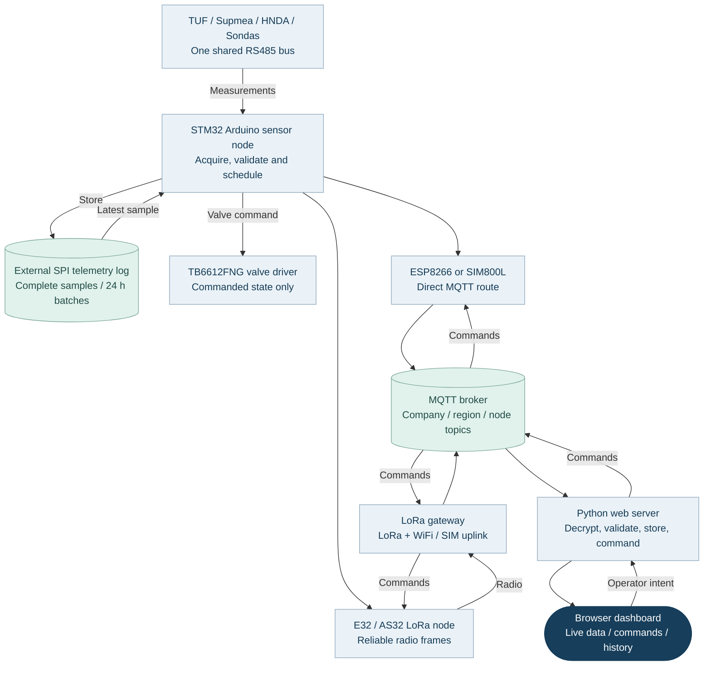

- The gateway forwards the encrypted node payload; the server decodes it. LoRa-only nodes do not use their IP-modem path.
- Solid arrows show functional data/control direction. All subsequent charts describe software behavior, not a new hardware wiring diagram.

Sources: Node/IoT_Node_Encrypted.ino:189; Node/src/app/GatewayApp.cpp:54; Server/server_web.py:987

## F02 Choose the compiled product

Build-time macros decide the role, active transport, sensor requests, addresses and power policy before any hardware is used.

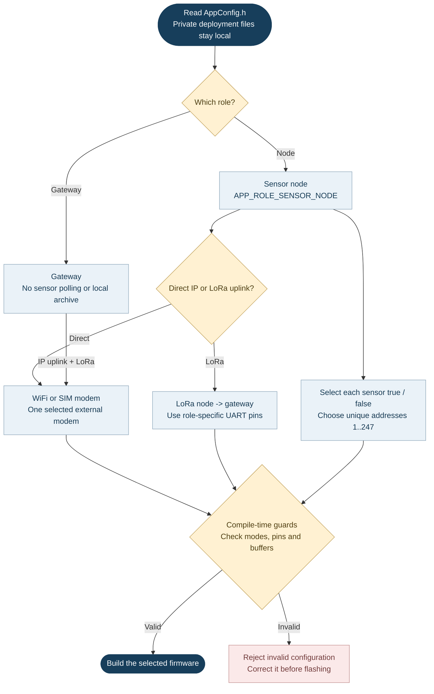

- All four sensors can be enabled together. There is no longer a mandatory exclusive two-sensor project selection.
- Current public snapshot: node 2, Company_1 / Region_1, LoRa WOR with UART RX wake, all four sensors and SPI logging enabled.

Sources: Node/src/config/AppConfig.h:185; Node/src/config/AppConfig.h:426

## F03 Boot and reset initialization

Safety and the Standby handoff run before the IWDG; normal active initialization then selects the node or gateway path.

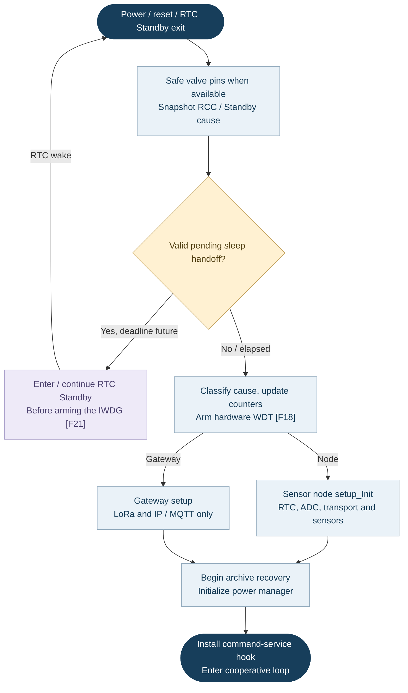

- The default RTC date is not proof of trusted time. STIME establishes validated UTC time for calendar totals and flash retention.
- The IWDG protects active startup calls as well as loop execution. A valid long Standby handoff deliberately occurs before it starts.

Sources: Node/IoT_Node_Encrypted.ino:189; Node/src/app/IoT_Node.cpp:441; Node/src/power/PowerManager.cpp:759

## F04 Sensor node cooperative main loop

Commands and replies precede sampling, routine uploads and bulk history. One enabled sensor is serviced per application pass.

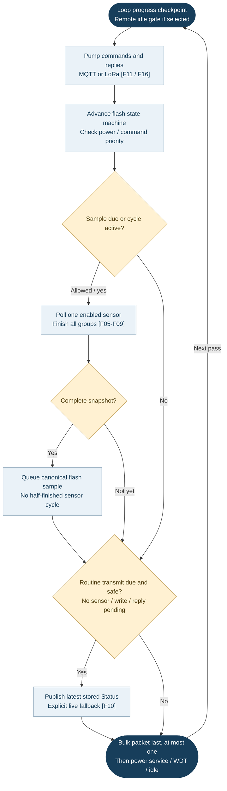

- Priority is cooperative: an in-flight modem, sensor or logical LoRa send cannot be preempted instantly.
- Remote-wake schedule mode uses separate sample/send deadlines. WOR and timed Standby use their existing report-cycle policies [F20-F22].

Sources: Node/IoT_Node_Encrypted.ino:222; Node/src/app/SensorPollCycle.h:7

## F05 RS485 request response and failure path

All four drivers share one half-duplex bus. Each request is bounded and every returned group carries its own validity.

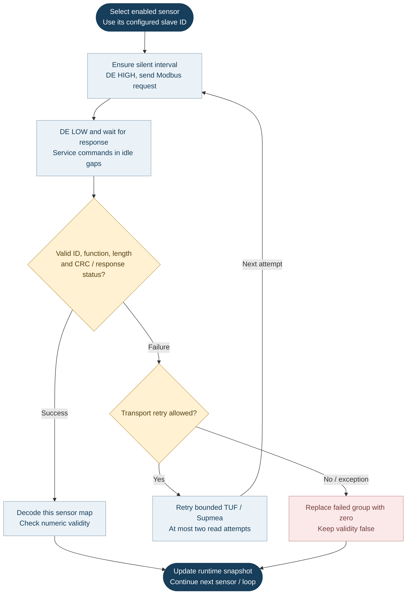

- Bus setting is 9600 baud, 8N1. TUF/Supmea retry transport errors; a valid Modbus exception is not retried. HNDA/Sondas reads use their current single-call path.
- The command idle hook pauses watchdog feeding so an endless Modbus wait cannot keep the controller alive forever.

Sources: Node/src/devices/Rs485Bus.cpp:36; Node/src/devices/Rs485Bus.cpp:26; Node/src/devices/TufSensor.cpp:58

## F06 TUF flow and native period totals

TUF supplies its own day/month/year volumes. Its 32-bit values use low-word-first register pairs, unlike Supmea.

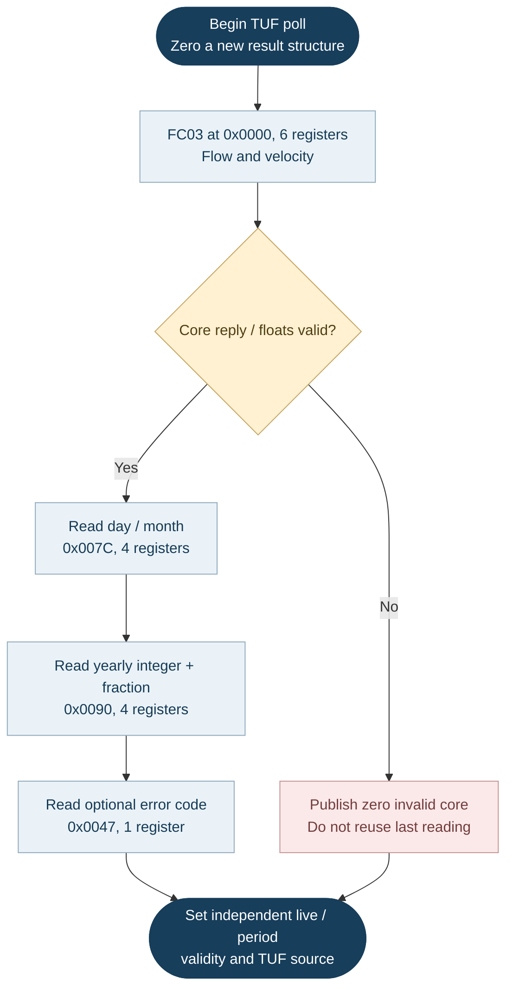

- Modbus bytes within each 16-bit register retain standard bus order. The TUF driver combines the low register word first; it does not blindly reverse every byte.
- Day/month are float values. Year is signed integer part plus float fraction. Optional totalizer failures do not invalidate an otherwise good live group.

Sources: Node/src/devices/TufSensor.cpp:126; Node/src/app/FlowMeterManager.cpp:106

## F07 Supmea live data and cumulative totals

The FMC240 driver decodes high-word-first IEEE-754 floats and normalizes volumetric flow before updating RTC consumption.

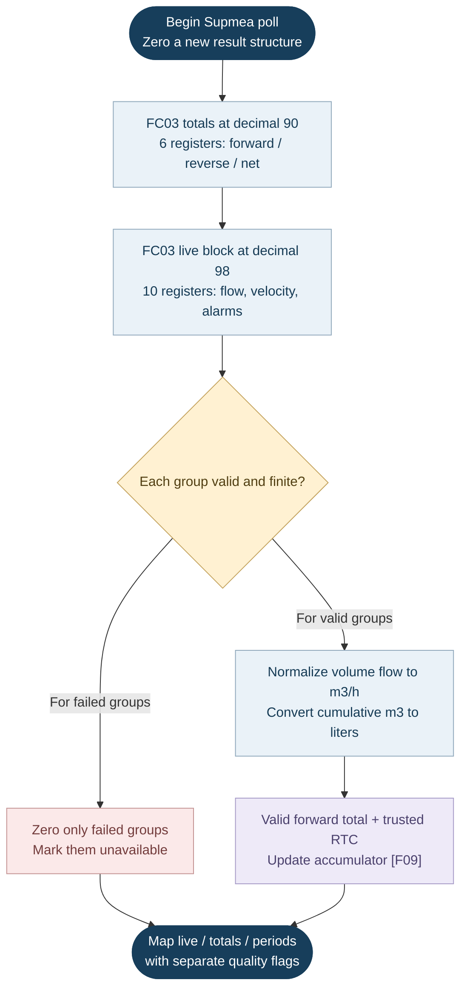

- Alarm bits include EPD and excitation-current alarm. A valid Modbus response does not by itself mean alarm-free physical measurement.
- L/h, L/min, L/s, m3/h, m3/min and m3/s are supported. Mass-flow units are not silently treated as volumetric flow.

Sources: Node/src/devices/SupmeaSensor.cpp:127; Node/src/app/FlowMeterManager.cpp:159

## F08 HNDA and Sondas soil measurements

The two soil probes have separate addresses, enable switches and payload fields even when both are on the same RS485 pair.

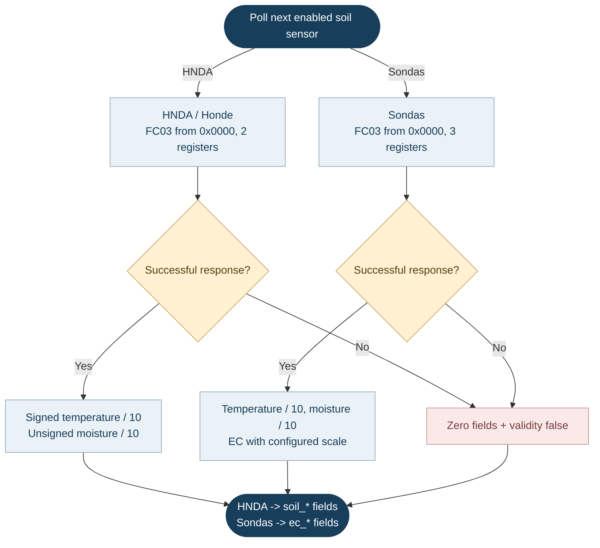

- HNDA is the Honde sensor called Honda in earlier project discussions. It is named HNDA in the current code.
- The Sondas register layout is configurable; the supplied family document did not establish a complete purchased-probe map. Confirm it on the actual probe.

Sources: Node/src/devices/HndaSensor.cpp:61; Node/src/devices/SondasSensor.cpp:61; Node/src/comm/SensorPayloadMapper.h:50

## F09 Supmea RTC day month and year consumption

Consumption comes from the accepted change in cumulative forward liters. RTC calendar keys decide the current day/month/year buckets.

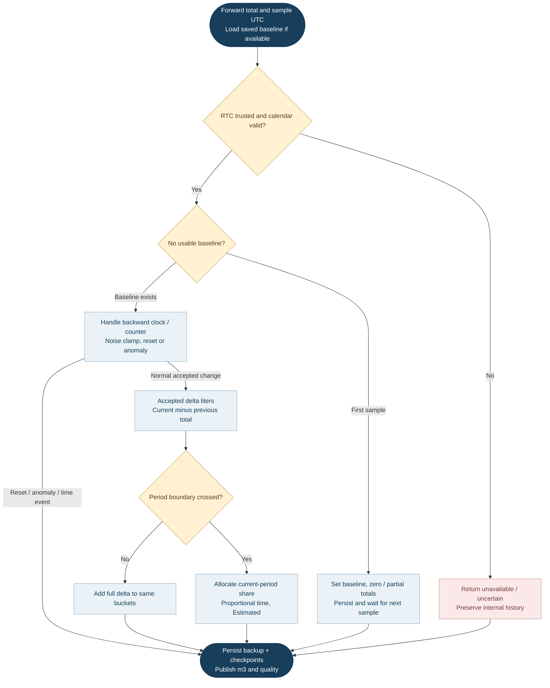

- UTC RTC is converted using the configured UTC, fixed-offset or Africa/Cairo calendar policy. Cross-boundary allocation is an estimate, not a meter-provided daily register.
- The first partial period cannot recover water consumed before its baseline. Backup state and durable checkpoints reduce loss but do not invent missing history.

Sources: Node/src/app/SupmeaPeriodAccumulator.cpp:501; Node/src/devices/RTC.cpp:351

## F10 Build a truthful telemetry payload

Sensor validity, acquisition time and operational state remain explicit from runtime mapping through protobuf and the existing AES envelope.

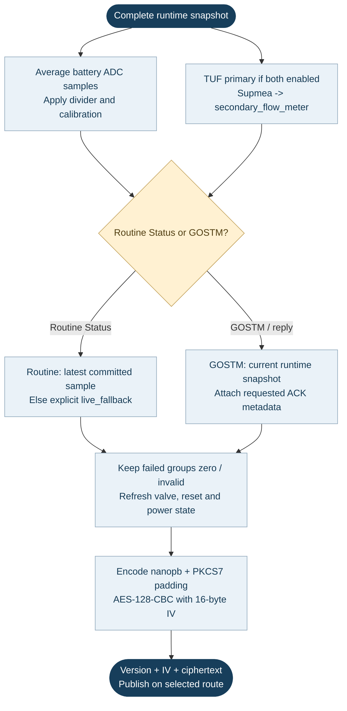

- Stored Status retains acquisition time/sequence, while commanded valve state and reset/power fields are current. HNDA and Sondas keep independent soil fields.
- The existing AES-CBC envelope has no authentication tag, and its runtime IV source is not cryptographically secure. No secret key is printed in this documentation.

Sources: Node/src/devices/BatteryMonitor.cpp:37; Node/src/comm/TelemetryPayload.cpp:18; Node/src/comm/PacketCodec.cpp:82

## F11 Direct MQTT receive and send priorities

TinyGSM owns AT transactions. Checked buffered sends and a bounded priority queue keep command replies ahead of routine status.

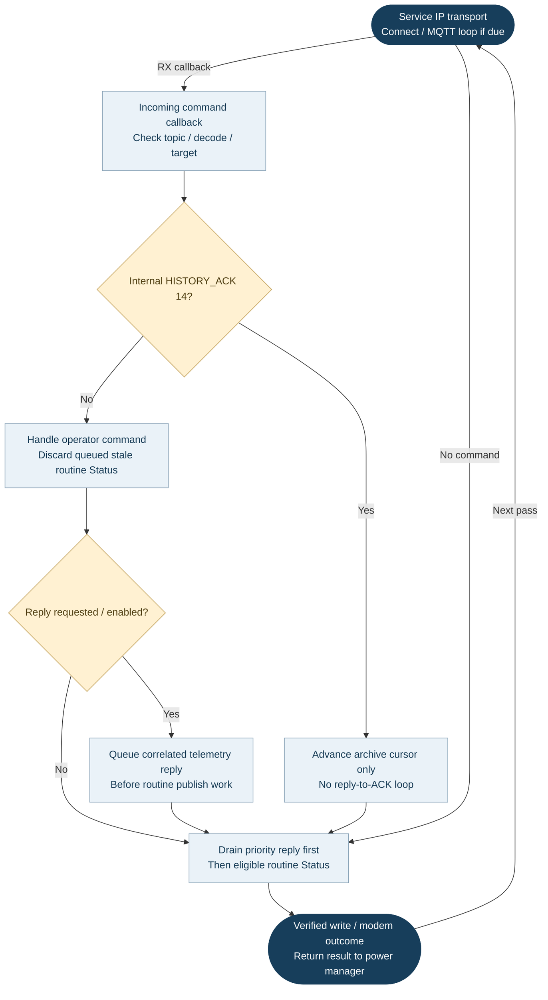

- The application queue is bounded; this is not an unlimited offline mailbox. Returned write success is checked, including partial modem writes.
- Modem SEND OK or MQTT QoS 0 acceptance is not server execution or persistence. History uses its additional application ACK [F25].

Sources: Node/src/comm/MQTT.cpp:308; Node/src/comm/MQTT.cpp:666; Node/src/comm/PriorityPublishQueue.h:11

## F12 WiFi SIM connection and retry recovery

Physical network failures count separately from broker-only failures. Recovery has a modem-reset stage followed by a controller-reset stage.

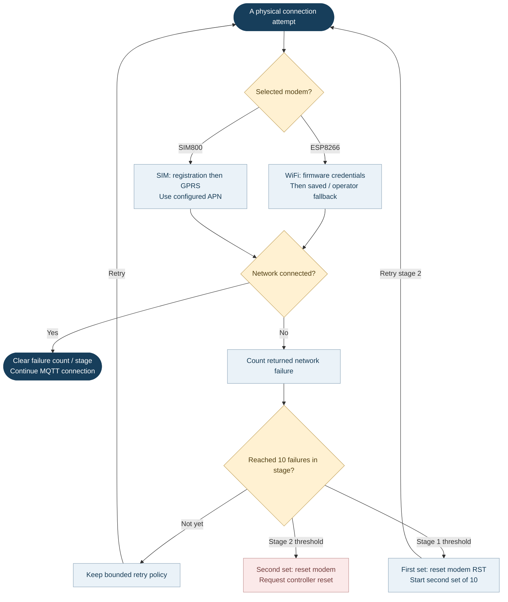

- A call that never returns is handled by the 30 s IWDG, not the returned-failure counter. With IWDG armed, the deliberate controller reset is itself watchdog-driven.
- WiFi tries compiled settings first; saved flash credentials are fallback. A lengthy network outage can prevent sampling during startup/retries; continuous offline acquisition is not guaranteed.

Sources: Node/src/app/IoT_Node.cpp:330; Node/src/app/NetworkRetryPolicy.h:10; Node/src/comm/MQTT.cpp:234

## F13 LoRa wire transport and reassembly

Small physical frames carry a bounded encrypted logical message. CRC, fragment identity, retry and reassembly protect the radio transport.

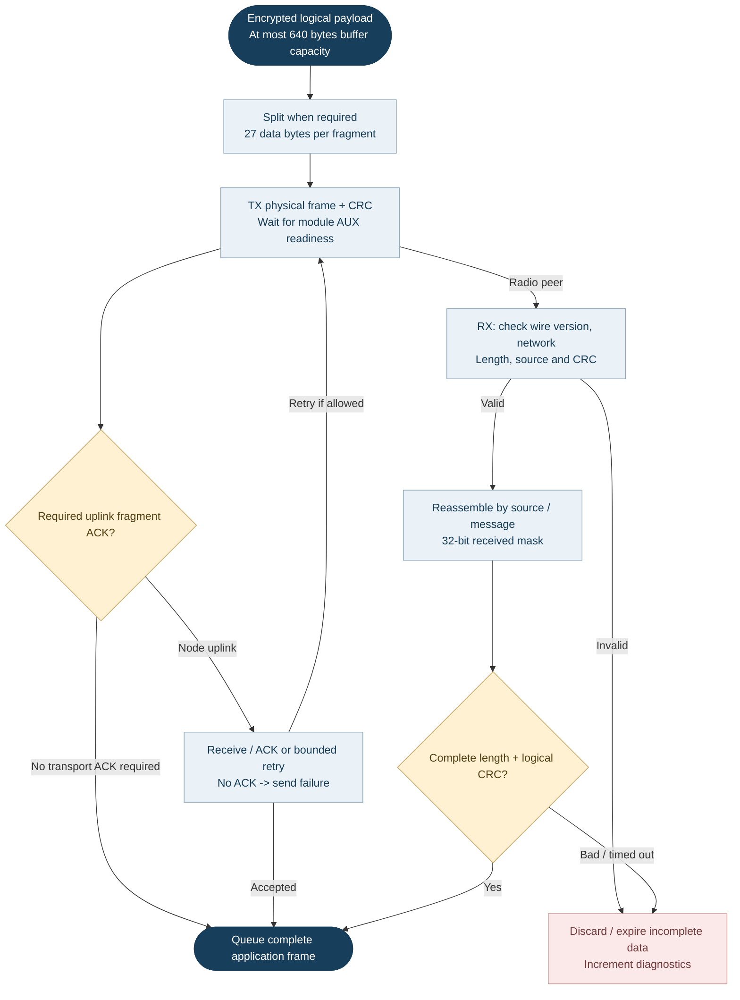

- Physical wire maximum is 48 bytes; the current 640-byte capacity needs at most 24 fragments. Fragment ACKs confirm radio transport, not server record persistence.
- Use matched radio settings and unique node IDs on a shared channel. Traffic can collide. E32-TTL-100 UART RSSI is unsupported, so no invented fixed dBm is used.

Sources: Node/src/radio/LoraLink.cpp:1380; Node/src/radio/LoraLink.cpp:853; Node/src/radio/AS32_Config.h:78

## F14 Gateway bridge and downlink forwarding

The gateway gives an active radio fragment transaction priority, then bridges complete encrypted payloads using regional node topics.

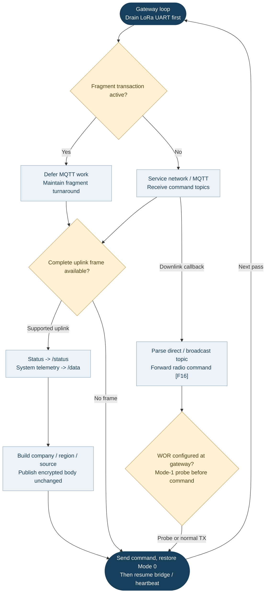

- Gateway role remains controller NORMAL. It does not poll the sensor bus or keep the leaf node SPI telemetry log.
- The new larger storage replies require an updated gateway as well as updated nodes. Delivery to MQTT is not a substitute for server application ACK.

Sources: Node/src/app/GatewayApp.cpp:54; Node/src/comm/MQTT.cpp:361

## F15 Server command intent and delivery lifecycle

Commands are durable, scoped operator intents. Broker receipt and matching node execution replies are separate events.

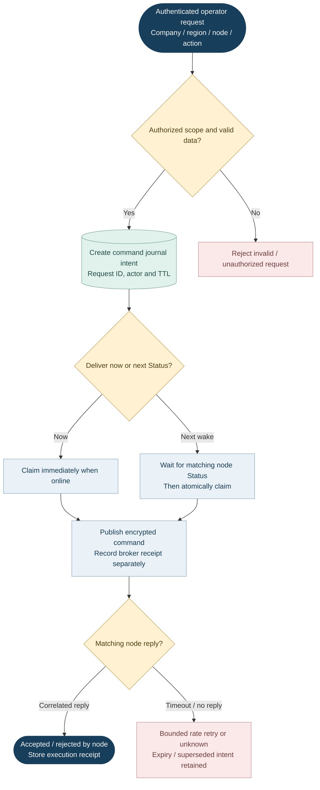

- Only SRATE and STRAN have bounded automatic retries. Valve, STIME, counter clears and flash commands are not automatically repeated as uncertain actions.
- Broadcast replies describe individual nodes, never confirmed execution by an entire fleet. A sleeping node must be reachable or wait until its next report.

Sources: Server/server_web.py:1648; Server/command_queue.py:180; Server/command_queue.py:305

## F16 Node command dispatch replay and replies

The shared command policy covers direct MQTT and LoRa. Internal archive ACKs and explicit data requests have distinct behavior.

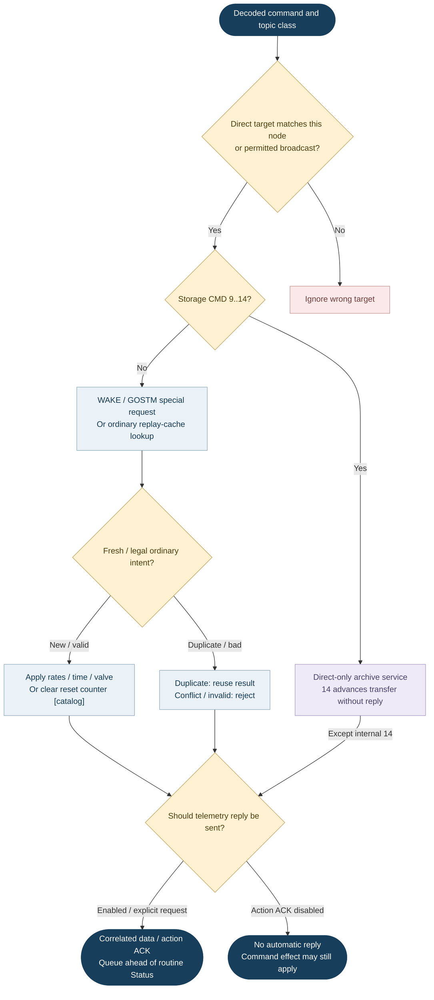

- GOSTM plus FLASH_STATUS / LAST / TODAY explicitly request replies even when automatic action ACKs are off. CMD14 never creates a telemetry reply.
- Ordinary replay tracking is bounded RAM. Flash clear separately persists its most recent manual request ID; it is not an unlimited ledger of every past intent.

Sources: Node/src/comm/CommandHandler.cpp:39; Node/src/comm/CommandHandler.h:35; Node/src/comm/CommandReplayCache.h:11

## F17 Commissioned latching valve pulse

The TB6612FNG drives a polarity pulse and then turns the bridge off. Telemetry records commanded state, not physical position feedback.

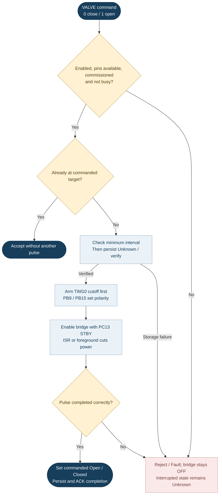

- LoRa uses PC13 for AUX, so the current profile inhibits the PC13 valve output. A new pin assignment needs an explicit wiring/configuration change.
- A completed pulse with a failed final durable save is still acknowledged as executed; RAM holds the target and reboot can recover Unknown. No WDT feeding is added inside the pulse wait.

Sources: Node/src/devices/ValveController.cpp:113; Node/src/devices/ValveController.cpp:96; Node/src/config/AppConfig.h:702

## F18 Watchdog reset causes and two counters

The hardware IWDG resets stalled active code. Only genuine power-on/brownout and IWDG causes increment their corresponding persistent counters.

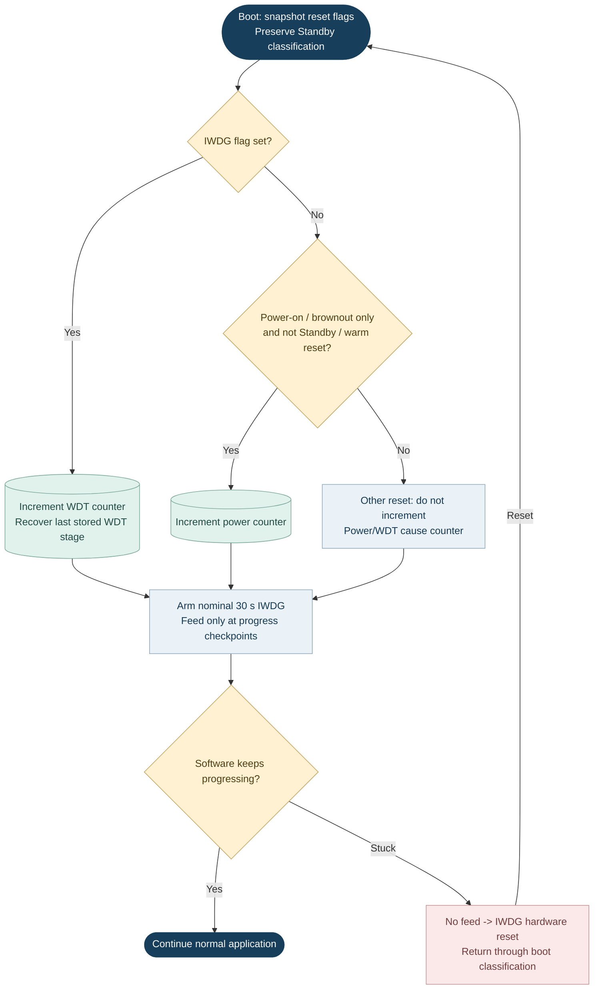

- RESET-button / ST-Link software reset / planned Standby wake do not count as power resets. Deliberate WDT-based network recovery still counts as an IWDG reset.
- Direct CMD7 clears the power count; CMD8 clears the WDT count. Readback verification, duplicate checks and ACK result expose storage failure. RTC alarms, not the WDT, schedule normal wakeups.

Sources: Node/src/platform/Watchdog.cpp:124; Node/src/platform/ResetCause.h:11; Node/src/platform/WatchdogResetCounter.cpp:77

## F19 Select a supported power policy

Controller state and selected-radio policy must form a supported pair. The compiler rejects unsupported combinations.

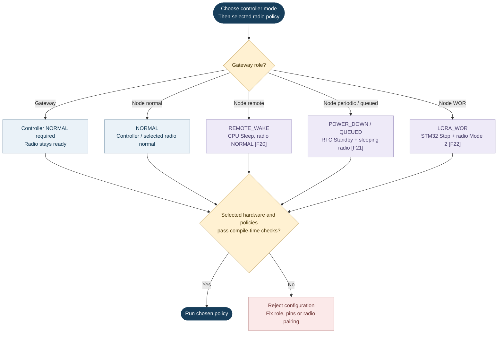

- Direct SIM800 deep/queued Standby is rejected on this PCB: PWRKEY/DTR/RI are not routed. SIM may remain NORMAL while the controller uses REMOTE_WAKE.
- STM32 Stop reception is implemented through LoRa WOR Mode 2. This does not make an arbitrary normal modem able to wake the MCU from Standby. See the combination appendix.

Sources: Node/src/config/AppConfig.h:216; Node/src/power/PowerManager.cpp:1033

## F20 Remote wake with normal connected modem

The reachable-idle controller uses light CPU Sleep while the radio remains connected. The default policy responds to independent sampling and send deadlines.

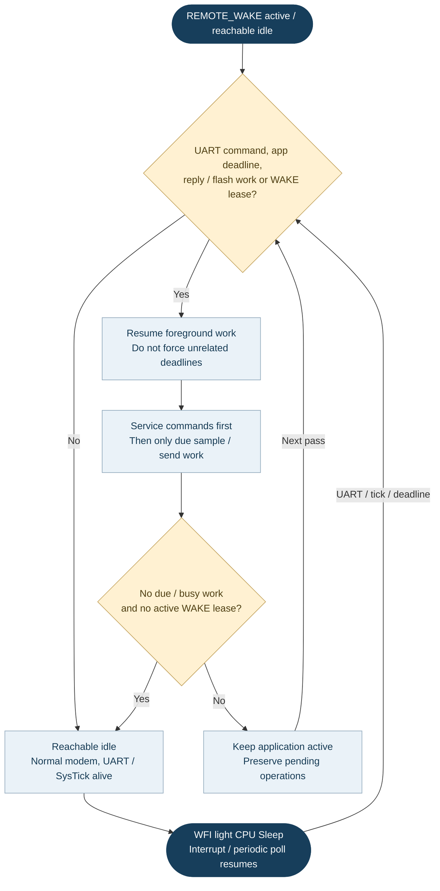

- Default APP_REMOTE_WAKE_USE_APP_SCHEDULE=true uses SRATE and STRAN separately. false retains the older fixed-cycle remote policy.
- WAKE requests an active lease of 1..86400 s; data 0 uses the configured default. Flash work/transfer guards prevent inappropriate idling; this is not RTC Standby or a modem DTR sleep implementation.

Sources: Node/src/power/PowerManager.cpp:1172; Node/src/power/RemoteWakeCycle.h:72; Node/src/config/AppConfig.h:105

## F21 Periodic and queued RTC Standby

A successful report opens a command window. Standby is entered through a verified reset handoff so active work keeps watchdog protection.

```mermaid
flowchart TD
  a(["Fresh sample and successful report"]):::term
  b["Command window<br/>Periodic or longer queued policy"]:::proc
  c{"Window elapsed, no active lease<br/>transport / flash idle and RTC valid?"}:::dec
  d["Keep awake / retry preparation<br/>Queued command can hold WAKE lease"]:::proc
  e["Put radio into supported sleep<br/>Put idle flash into deep power-down"]:::proc
  f[("Store checked RTC sleep request<br/>Limit deadline by flash expiry")]:::db
  g["Software reset<br/>Early boot before IWDG [F03]"]:::proc
  h(["Enter Standby until RTC deadline<br/>Wake is a new startup"]):::term
  i["Abort failed handoff<br/>Restore active scheduling"]:::bad
  a --> b
  b --> c
  c -->|Not ready| d
  d -->|Later pass| c
  c -->|Ready| e
  e --> f
  f -->|Verified| g
  f -->|Failure| i
  g --> h
  h -->|RTC boot + work| a
  classDef term fill:#173E5B,color:white,stroke:#173E5B
  classDef proc fill:#EAF2F8,color:#163B55,stroke:#91A9BC
  classDef dec fill:#FFF1D2,color:#513F12,stroke:#C4A35E
  classDef db fill:#E1F2ED,color:#214B43,stroke:#7DA89B
  classDef bad fill:#FBE9E9,color:#733C3C,stroke:#C49393
  classDef ref fill:#EEEAF8,color:#4B416D,stroke:#A69BC7
```

- ESP8266 or LoRa periodic/queued profiles require the matching radio POWER_DOWN policy. The present direct SIM800 hardware rejects this mode.
- Queued server commands wait for the next Status; this does not make a fully sleeping modem instantly reachable. Flash write/recovery/transfer work defers Standby.

Sources: Node/src/power/PowerManager.cpp:655; Node/src/power/PowerManager.cpp:759

## F22 LoRa wake on radio with STM32 Stop

The leaf radio listens in Mode 2 while STM32 RAM is retained in Stop. UART RX is the default wake interrupt; RTC handles heartbeat/report/retention deadlines.

```mermaid
flowchart TD
  a(["Report sent, command window elapsed<br/>No lease / busy transfer / write"]):::term
  b["Enter radio Mode 2<br/>M0 LOW, M1 HIGH; verify readiness"]:::proc
  c["Arm UART RX falling-edge wake<br/>Set nearest RTC alarm; flash sleeps"]:::proc
  d{"Safe to enter Stop?<br/>Check pending edge / UART / RTC"}:::dec
  e["STM32 Stop with RAM retained"]:::proc
  f{"Wake source?<br/>Restore clocks before UART work"}:::dec
  g["UART activity: return Mode 0<br/>Receive command; data not yet proven"]:::proc
  h["RTC heartbeat: service WDT<br/>If no deadline, return to Stop"]:::proc
  i(["Report / flash expiry due<br/>Return for scheduled work"]):::term
  j["Activity or setup failure<br/>Stay active / preserve received bytes"]:::bad
  a --> b
  b --> c
  c --> d
  d -->|Yes| e
  d -->|No| j
  e --> f
  f -->|RX| g
  f -->|Heartbeat| h
  f -->|Deadline| i
  h -->|Still waiting| c
  g -->|After work / window| a
  classDef term fill:#173E5B,color:white,stroke:#173E5B
  classDef proc fill:#EAF2F8,color:#163B55,stroke:#91A9BC
  classDef dec fill:#FFF1D2,color:#513F12,stroke:#C4A35E
  classDef db fill:#E1F2ED,color:#214B43,stroke:#7DA89B
  classDef bad fill:#FBE9E9,color:#733C3C,stroke:#C49393
  classDef ref fill:#EEEAF8,color:#4B416D,stroke:#A69BC7
```

- Gateway WOR TX sends a Mode-1 probe before the command. AUX remains a readiness signal; the optional legacy AUX wake selector is separate from the default UART RX path.
- Default heartbeat is 15 s under the nominal 30 s IWDG. APP_POWER_SLEEP_SECONDS sets the WOR report deadline; heartbeat alone does not force a new sample. WDT expiry resets rather than scheduling wake.

Sources: Node/src/power/PowerManager.cpp:160; Node/src/power/WorWakeInput.h:30; Node/src/radio/LoraLink.cpp:1340

## F23 Capture and commit a flash sample

The external S25FL064L stores one canonical complete sample per accepted acquisition, with CRC and commit-last recovery.

```mermaid
flowchart TD
  a(["All sensor groups completed"]):::term
  b{"Enabled, ready, trusted time<br/>and unexpired generation?"}:::dec
  c["Encode canonical Telemetry<br/>No command / history wrapper"]:::proc
  d{"Queue has room and log not full?"}:::dec
  e["Allocate / verify current sector<br/>Program two body pages"]:::proc
  f["Poll completion in later passes<br/>Read back body / CRC"]:::proc
  g[("Write commit marker last<br/>Update count / latest sequence")]:::db
  h["Count skipped / dropped sample<br/>Keep reporting with honest source"]:::bad
  i["I/O / status / timeout failure<br/>Latch Fault, no silent success"]:::bad
  a --> b
  b -->|Yes| c
  b -->|No| h
  c --> d
  d -->|Yes| e
  d -->|No| h
  e --> f
  f -->|Verified| g
  f -->|Failed| i
  classDef term fill:#173E5B,color:white,stroke:#173E5B
  classDef proc fill:#EAF2F8,color:#163B55,stroke:#91A9BC
  classDef dec fill:#FFF1D2,color:#513F12,stroke:#C4A35E
  classDef db fill:#E1F2ED,color:#214B43,stroke:#7DA89B
  classDef bad fill:#FBE9E9,color:#733C3C,stroke:#C49393
  classDef ref fill:#EEEAF8,color:#4B416D,stroke:#A69BC7
```

- JEDEC 01 60 17 identifies the configured 8 MiB chip. Four RAM queue entries feed 512-byte slots with at most 472 canonical protobuf bytes each.
- Capacity is 14,322 records. Full means stop appending and count drops, not overwrite unexpired records. A return from append means queued, not yet durable.

Sources: Node/src/storage/TelemetryArchive.cpp:72; Node/src/storage/TelemetryJournal.cpp:100; Node/src/storage/S25Fl064l.cpp:40

## F24 Flash recovery retention and clearing

Two metadata copies choose a durable generation. Records recover cooperatively; retention changes the generation before background physical reclamation.

```mermaid
flowchart TD
  a(["Probe chip / read metadata copies"]):::term
  b{"Recognized chip + valid format?"}:::dec
  c["Recover valid committed records<br/>Skip torn / CRC-bad slots"]:::proc
  d["Missing: retry probe<br/>Unformatted: explicit clear required"]:::bad
  e{"Trusted 24-hour expiry<br/>or accepted CLEAR_FLASH?"}:::dec
  f[("Commit alternate metadata<br/>New generation / retention start")]:::db
  g["Old records no longer exposed<br/>Sweep old sectors cooperatively"]:::proc
  h{"Sector now owned by new log?"}:::dec
  i["Protect it; skip this sector"]:::proc
  j["Erase old sector if necessary<br/>Persist sweep completion"]:::proc
  k(["Ready / Full: normal archive use"]):::term
  a --> b
  b -->|Yes| c
  b -->|No| d
  d -->|Manual initialization| e
  c --> e
  e -->|Yes| f
  e -->|No| k
  f --> g
  g --> h
  h -->|Yes| i
  h -->|No| j
  i -->|Next sector| g
  j -->|Next sector| g
  classDef term fill:#173E5B,color:white,stroke:#173E5B
  classDef proc fill:#EAF2F8,color:#163B55,stroke:#91A9BC
  classDef dec fill:#FFF1D2,color:#513F12,stroke:#C4A35E
  classDef db fill:#E1F2ED,color:#214B43,stroke:#7DA89B
  classDef bad fill:#FBE9E9,color:#733C3C,stroke:#C49393
  classDef ref fill:#EEEAF8,color:#4B416D,stroke:#A69BC7
```

- Retention is 24 elapsed hours from the persisted batch start, not local midnight. Untrusted/backward time cannot trigger automatic erase.
- Ownership is rechecked on every sweep pass so newly allocated samples cannot be erased. Clear ACK is acceptance; physical erase progress may continue across active windows.

Sources: Node/src/storage/TelemetryJournal.cpp:26; Node/src/storage/TelemetryJournal.cpp:159; Node/src/storage/TelemetryJournal.cpp:78

## F25 Download retained history with persistence ACK

FLASH_TODAY freezes the node day and final sequence. The node sends one indexed row at a time and advances only after server storage acknowledgment.

```mermaid
flowchart TD
  a(["Direct FLASH_TODAY / resume<br/>Require retained trusted log"]):::term
  b["Freeze day, generation, final seq<br/>Count matching valid records"]:::proc
  c["Read next CRC-valid sample<br/>Attach request / index / total"]:::proc
  d["Send after priority work<br/>Server commits scoped row [F26]"]:::proc
  e{"Matching internal CMD14 received?"}:::dec
  f["Advance cursor<br/>Send next row or successful End"]:::proc
  g["Bounded retry same row<br/>Then ACK-timeout terminal result"]:::proc
  h{"Cancel / expiry / read error?"}:::dec
  i(["Send explicit terminal result<br/>Release after ACK / bounded timeout"]):::term
  a --> b
  b --> c
  b -->|Empty result| i
  c --> d
  d --> e
  e -->|Yes| f
  e -->|Timeout| g
  g -->|Attempts remain| d
  g -->|Exhausted| i
  f -->|More rows| c
  f -->|End| i
  b -->|During job| h
  h -->|Yes| i
  h -->|No| c
  classDef term fill:#173E5B,color:white,stroke:#173E5B
  classDef proc fill:#EAF2F8,color:#163B55,stroke:#91A9BC
  classDef dec fill:#FFF1D2,color:#513F12,stroke:#C4A35E
  classDef db fill:#E1F2ED,color:#214B43,stroke:#7DA89B
  classDef bad fill:#FBE9E9,color:#733C3C,stroke:#C49393
  classDef ref fill:#EEEAF8,color:#4B416D,stroke:#A69BC7
```

- FLASH_LAST is a single original sample, not a new sensor poll. TODAY covers only the retained batch portion of the current node calendar day, not necessarily a complete day.
- New acquisition remains allowed while download keeps the controller awake; later records are excluded from the frozen job. Server history does not feed live charts or consumption.

Sources: Node/src/storage/TelemetryArchive.cpp:164; Server/flash_archive.py:74; Server/server_web.py:134

## F26 Server receive validate and store

Incoming MQTT frames are decrypted and checked against exact regional topic identity before any live update, command receipt or archive persistence.

```mermaid
flowchart TD
  a(["MQTT RX frame<br/>Bounded topic / payload size"]):::term
  b["Check envelope, decrypt AES<br/>Validate PKCS7 / parse protobuf"]:::proc
  c{"Topic, node ID, numbers<br/>and enum fields valid?"}:::dec
  d["Status / live Telemetry<br/>Select measured time / quality"]:::proc
  e["Flash metadata / history<br/>Separate archive transaction"]:::proc
  f["Command echo<br/>Internal ACK14 is not live history"]:::proc
  g[("Store live readings / periods<br/>Deduplicate flow samples")]:::db
  h[("Store archive row / transfer<br/>Only then send HISTORY_ACK")]:::db
  i(["Emit scoped dashboard events<br/>Dispatch queued command on Status"]):::term
  j["Drop and log invalid message<br/>No database / execution ACK effect"]:::bad
  a --> b
  b -->|Decoded| c
  b -->|Decode failed| j
  c -->|Valid live| d
  c -->|Valid archive| e
  c -->|Valid command| f
  c -->|Invalid| j
  d --> g
  e --> h
  g --> i
  h --> i
  f -->|Operator echo only| i
  classDef term fill:#173E5B,color:white,stroke:#173E5B
  classDef proc fill:#EAF2F8,color:#163B55,stroke:#91A9BC
  classDef dec fill:#FFF1D2,color:#513F12,stroke:#C4A35E
  classDef db fill:#E1F2ED,color:#214B43,stroke:#7DA89B
  classDef bad fill:#FBE9E9,color:#733C3C,stroke:#C49393
  classDef ref fill:#EEEAF8,color:#4B416D,stroke:#A69BC7
```

- Topics are wiot/company/region/node/status, /data, /cmd, plus regional /broadcast. Topic node and protobuf node must agree; a good AES decode alone is insufficient.
- Stored sample_time_valid is independent of the primary meter RTC flag. Original acquisition time is used when trusted, with explicit fallback provenance in live history.

Sources: Server/mqtt_impl.py:67; Server/server_web.py:987; Server/input_validation.py:50

## F27 Server users dashboard reports and isolation

The web application separates authenticated views, company scope and privileged infrastructure actions while displaying live and archived data.

```mermaid
flowchart TD
  a(["Start server / initialize databases<br/>Initial users require local secrets"]):::term
  b["Login and verify password hash<br/>Establish role / company session"]:::proc
  c{"User request authorized?"}:::dec
  d["Live dashboard / history / graphs<br/>Thresholds, map and node details"]:::proc
  e["Admin: commands, user / node config<br/>Supervisor: shared broker controls"]:::proc
  f["Flash archive status / progress<br/>Stored records and CSV export"]:::proc
  g["Scope every query / event<br/>Company + region + node"]:::proc
  h(["Return API / Socket.IO view<br/>Safe text rendering / bounded history"]):::term
  i["Reject unauthorized request<br/>No cross-company side effect"]:::bad
  a --> b
  b --> c
  c -->|Read view| d
  c -->|Permitted action| e
  c -->|Archive query| f
  c -->|Denied| i
  d --> g
  e --> g
  f --> g
  g --> h
  classDef term fill:#173E5B,color:white,stroke:#173E5B
  classDef proc fill:#EAF2F8,color:#163B55,stroke:#91A9BC
  classDef dec fill:#FFF1D2,color:#513F12,stroke:#C4A35E
  classDef db fill:#E1F2ED,color:#214B43,stroke:#7DA89B
  classDef bad fill:#FBE9E9,color:#733C3C,stroke:#C49393
  classDef ref fill:#EEEAF8,color:#4B416D,stroke:#A69BC7
```

- Live readings/periods, command intentions/receipts and external-flash downloads have different persistence paths. Clearing a node log does not delete already received server archive rows.
- Broker connection readiness includes subscription success. Ordinary company users do not receive shared infrastructure logs or control another company through a changed browser selector.

Sources: Server/server_web.py:1211; Server/server_web.py:1205; Server/static/js/flash_archive.js:32

## F28 Four sensor simulator on one shared bus

The multi-sensor lab hosts multiple virtual devices per sensor type, each with a unique address and independently configured signal behavior.

```mermaid
flowchart TD
  a(["Configure COM port / bus<br/>Add / clone / batch-add devices"]):::term
  b["Validate unique slave addresses<br/>Choose fixed / dynamic signal values"]:::proc
  c["Simulation tick updates devices<br/>Totals + local Supmea calendar oracle"]:::proc
  d{"Serial request with valid CRC?"}:::dec
  e["Route to enabled device address<br/>Validate function / register range"]:::proc
  f["Encode that sensor register map<br/>Apply selected fault / delay behavior"]:::proc
  g(["Reply with CRC / exception<br/>Or intentional silence / corruption"]):::term
  h["Ignore noise / unknown address<br/>Update traffic counters"]:::proc
  i["GUI readings / logs / oracle CSV<br/>Compare node and simulator totals"]:::proc
  a --> b
  b --> c
  c --> d
  d -->|Yes| e
  d -->|No / no device| h
  e --> f
  f --> g
  c --> i
  g -->|Next request| d
  h -->|Continue| d
  classDef term fill:#173E5B,color:white,stroke:#173E5B
  classDef proc fill:#EAF2F8,color:#163B55,stroke:#91A9BC
  classDef dec fill:#FFF1D2,color:#513F12,stroke:#C4A35E
  classDef db fill:#E1F2ED,color:#214B43,stroke:#7DA89B
  classDef bad fill:#FBE9E9,color:#733C3C,stroke:#C49393
  classDef ref fill:#EEEAF8,color:#4B416D,stroke:#A69BC7
```

- Several HNDA, TUF, Supmea and Sondas devices can share the simulator bus. The node still polls only its configured addresses; duplicate addresses on a physical bus are invalid.
- The independent Supmea day/month/year reference stays local to the simulator and is not injected into the RS485 meter map. Focused TUF/Supmea simulators remain available.

Sources: MultiSensor/multi_sensor_simulator.py:606; MultiSensor/multi_sensor_bus.py:51; MultiSensor/multi_sensor_core.py:866

## F29 Verify document and release the project

A release includes matched node/server schemas, behavioral regressions, firmware bounds, human documentation and a separate hardware acceptance step.

```mermaid
flowchart TD
  a(["Authorized project change<br/>Preserve deployment secrets"]):::term
  b["Regenerate matching schemas<br/>If the protocol changed"]:::proc
  c["Run native / server / simulator<br/>And cross-component regression suites"]:::proc
  d["Build firmware profiles<br/>Check flash load / RAM / EEPROM area"]:::proc
  e{"Checks pass?"}:::dec
  f["Update guides / Doxygen / flows<br/>Synchronize verified final folder"]:::proc
  g["Create new feature branch<br/>Publish complete change and verify ref"]:::proc
  h(["Run physical acceptance<br/>Supply, sensors, RF, power, flash soak"]):::term
  i["Fix defect and repeat<br/>Do not claim hardware validation"]:::bad
  a --> b
  b --> c
  c --> d
  d --> e
  e -->|Yes| f
  e -->|No| i
  i -->|Recheck| c
  f --> g
  g --> h
  classDef term fill:#173E5B,color:white,stroke:#173E5B
  classDef proc fill:#EAF2F8,color:#163B55,stroke:#91A9BC
  classDef dec fill:#FFF1D2,color:#513F12,stroke:#C4A35E
  classDef db fill:#E1F2ED,color:#214B43,stroke:#7DA89B
  classDef bad fill:#FBE9E9,color:#733C3C,stroke:#C49393
  classDef ref fill:#EEEAF8,color:#4B416D,stroke:#A69BC7
```

- Internal firmware flash load is kept below the reserved EEPROM sector at 0x08020000. Source/docs delivery does not flash the board or prove physical operation.
- ESP32 and STM32CubeIDE do not automatically receive Arduino STM32 updates. Keep .env, AppSecrets, private AppConfig.cpp and runtime databases out of Git.

Sources: Validate-Release.ps1:14; regenerate_protocol.py:15; Node/SPI_FLASH_TEST_PLAN.md:1

## F30 Active release and separate firmware ports

The repository contains three firmware implementations. The detailed current flowcharts describe the Arduino STM32 release; alternate ports retain their own snapshots.

```mermaid
flowchart TD
  a(["Select project to build"]):::term
  b["Arduino STM32F401<br/>Active release documented here"]:::proc
  c["ESP32 Arduino port<br/>Separate architecture snapshot"]:::proc
  d["STM32CubeIDE HAL port<br/>Separate native implementation"]:::proc
  e["Current sensing / commands / WDT<br/>Power modes / RTC totals / SPI log"]:::proc
  f["Remapped three UART roles<br/>External ESP8266 / SIM retained"]:::proc
  g["SensorNode / LoRaGateway<br/>HAL startup, UART rings, drivers"]:::proc
  h(["Use this book F01-F29<br/>for active release behavior"]):::term
  i(["Inspect own config and schema<br/>Do not assume current feature parity"]):::term
  a --> b
  a --> c
  a --> d
  b --> e
  c --> f
  d --> g
  e --> h
  f --> i
  g --> i
  classDef term fill:#173E5B,color:white,stroke:#173E5B
  classDef proc fill:#EAF2F8,color:#163B55,stroke:#91A9BC
  classDef dec fill:#FFF1D2,color:#513F12,stroke:#C4A35E
  classDef db fill:#E1F2ED,color:#214B43,stroke:#7DA89B
  classDef bad fill:#FBE9E9,color:#733C3C,stroke:#C49393
  classDef ref fill:#EEEAF8,color:#4B416D,stroke:#A69BC7
```

- The ESP32 compatibility port uses external modems; it does not silently switch the project to ESP32 internal WiFi. Its UART mapping is role dependent.
- Neither alternate port has been updated by the recent active STM32 storage/power/command releases. Historical compatibility claims must be checked against that port's actual schema and code.

Sources: ESP32/ESP32_USER_GUIDE.md:3; CubeIDE/README.md:1; Node/README.md:1
