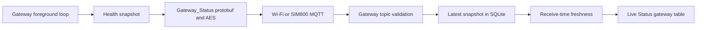

# WIOT gateway heartbeat design and operation

Version 1.0 • 18 November 2026 • Arduino STM32 gateway and Python server

## Objective and implemented plan

An operator needs to distinguish a working gateway with quiet sensor nodes from a gateway whose reports have stopped. A gateway-owned MQTT status message provides that indication independently of incoming LoRa frames.

1. Give each gateway an identity within its company and region, a heartbeat enable switch and a report interval.
2. Encode a bounded Gateway_Status protobuf, wrap it with the existing project AES envelope and publish it directly over the gateway's selected Wi-Fi or SIM800 uplink.
3. Schedule the first report after connection setup, then periodic reports. Resume reporting promptly after reconnecting and defer heartbeat work during LoRa receive transactions or command-priority work.
4. Route and persist the heartbeat separately from sensor data, then expose its freshness through an authenticated API scoped to company and region.
5. Show the gateway table on Live Status and verify silent-node operation, reboot/reconnect, missed reports, invalid input and routing isolation.

## Architecture



Sensor uplinks continue through the LoRa receive/forward path. The gateway heartbeat is generated by the gateway itself and remains available with zero sensor nodes transmitting. Debug printing can be completely disabled while heartbeat reporting remains enabled.

## Configuration

Set these options in `Node/IoT_Node_Encrypted/src/config/AppConfig.h` for a gateway build.

```cpp
#define APP_ROLE APP_ROLE_LORA_GATEWAY
#define APP_CONTROLLER_POWER_MODE APP_COMPONENT_MODE_NORMAL
#define APP_LORA_POWER_MODE APP_COMPONENT_MODE_NORMAL
#define APP_WIFI_POWER_MODE APP_COMPONENT_MODE_NORMAL
#define APP_SIM_POWER_MODE APP_COMPONENT_MODE_NORMAL

#define APP_ENABLE_GATEWAY_HEARTBEAT true
#define APP_GATEWAY_ID 1
#define APP_GATEWAY_HEARTBEAT_SECONDS 60UL
```

Select the gateway's existing Wi-Fi or SIM800 modem option for its IP uplink. Company and region use the existing `APP_MQTT_COMPANY` and `APP_MQTT_REGION` configuration. Give every gateway in the same company and region a unique APP_GATEWAY_ID from 1 through 65535. The allowed interval is 10 through 86400 seconds. Set APP_ENABLE_GATEWAY_HEARTBEAT to false to compile out periodic heartbeat sends.

The gateway MQTT client ID now appends `-gateway-{APP_GATEWAY_ID}` to the configured base client ID. This gives it a distinct broker identity when a node and gateway share the same compiled base client configuration. Nodes retain their established MQTT client-ID construction.

The existing APP_LORA_GATEWAY_WOR_TX option still selects the radio wake/probe behavior required for sleeping LoRa nodes. Gateway heartbeat scheduling uses the IP uplink and the configured foreground gateway loop.

## MQTT and serialization

Topic form is `wiot/{company}/{region}/gateway/{gateway_id}/status`.

For gateway 1 in Company_1 and Region_1, the topic is `wiot/Company_1/Region_1/gateway/1/status`. The server subscription is `wiot/+/+/gateway/+/status`.

Payload is the project's version/IV/AES-CBC envelope containing Gateway_Status. The gateway sends QoS 0 with retain=false through the existing checked modem-write path. A complete local modem write is the send result. The server updates life only after receiving, decrypting, validating and persisting a new heartbeat. Retained gateway heartbeats are ignored by server ingress so an old retained snapshot cannot refresh life after subscribing.

The new message is a separate protobuf type. Existing node telemetry/status and command field numbers remain the established V1 contract. Install the updated server with the gateway firmware so the new message and subscription are available.

## Gateway_Status fields

| Tag | Field | Type | Meaning |
|---|---|---|---|
| 1 | gateway_id | uint32 | Gateway identity matching the topic |
| 2 | uptime_seconds | uint64 | Time since this controller boot, extended across millis rollover |
| 3 | heartbeat_sequence | uint32 | Report attempt sequence since boot |
| 4 | heartbeat_interval_seconds | uint32 | Configured heartbeat interval |
| 5 | uplink_transport | uint32 | 1 for ESP8266 Wi-Fi, 2 for SIM800 |
| 6 | received_node_frames | uint32 | Completed node Status/Data frames handled by the gateway |
| 7 | forwarded_node_frames | uint32 | Node frames with a complete accepted local MQTT modem write |
| 8 | forward_failures | uint32 | Node forwarding send attempts that failed |
| 9 | has_node_uplink | bool | At least one node Status/Data frame observed since boot |
| 10 | last_node_age_seconds | uint64 | Time between the latest observed node frame and this heartbeat |
| 11 | wdt_reset_count | uint32 | Persisted controller watchdog reset count |
| 12 | power_reset_count | uint32 | Persisted controller power-on/brownout reset count |
| 13 | lora_aux_high | bool | Sampled AUX level at heartbeat construction |

Counters 6 through 8 count logical Status/Data messages after radio reassembly. Transport fragments, fragment ACKs, outgoing commands and wake probes are excluded. AUX is a digital pin observation. Its high level describes module readiness and provides no independent proof of a working RF path.

Uptime and activity counters restart when the gateway reboots. The reset counters come from the existing persistent watchdog module. Uptime is independent of RTC synchronization. The server records its own receipt timestamp for freshness.

A decoded example with quiet nodes is shown below. JSON illustrates the protobuf contents. The MQTT payload is the encrypted binary frame.

```json
{
  "gateway_id": 1,
  "uptime_seconds": 3600,
  "heartbeat_sequence": 61,
  "heartbeat_interval_seconds": 60,
  "uplink_transport": 1,
  "received_node_frames": 0,
  "forwarded_node_frames": 0,
  "forward_failures": 0,
  "has_node_uplink": false,
  "last_node_age_seconds": 0,
  "wdt_reset_count": 2,
  "power_reset_count": 5,
  "lora_aux_high": true
}
```

This example encodes to 17 protobuf bytes and a 49-byte encrypted envelope. The generated maximum is 80 protobuf bytes and 113 encrypted bytes. Actual size changes as counters grow. MQTT topic/header and network overhead are additional.

## Scheduling and priorities

On each gateway loop, the radio receive buffer is serviced first. Incomplete fragment transactions defer MQTT work. Once a complete uplink is available, the existing node forward path runs. Pending async publications are serviced between radio receive transactions.

The heartbeat runs after this work when the MQTT connection is ready, command-priority work is clear, no async publication is pending and no receive transaction is active. First publication and a new MQTT connection generation trigger a heartbeat as soon as these conditions permit. After a successful local send, the normal interval begins from send completion. A failed send waits at least five seconds before another attempt. This retry limit can also delay a reconnect-triggered heartbeat by up to five seconds. Missed heartbeat intervals produce a fresh snapshot when service resumes.

Heartbeat sends use the existing modem driver and may occupy the foreground for its bounded call duration. Heavy radio traffic and transport recovery can delay them. The overdue/offline thresholds allow multiple missed periods before declaring the receive path silent.

## Server states and UI

The server stores one latest heartbeat per company, region and gateway in `gateway_status.db` beside the main server database. Reboots update the same gateway row. The HTTP endpoint is `GET /api/gateways?company=Company_1&region=Region_1`. Tenant users receive their own company's data. Supervisor users can select a company. The region list includes regions discovered from gateway reports even when sensor history is empty.

| Display | Condition with a 60-second interval | Interpretation |
|---|---|---|
| Online | Age below 120 seconds | A recent heartbeat reached the server |
| Overdue | Age at least 120 and below 180 seconds | Two report periods have elapsed |
| Offline | Age at least 180 seconds | Three report periods have elapsed |
| Awaiting heartbeat | Server MQTT disconnected or no fresh report during the current observation session | Current gateway reachability awaits confirmation |

The browser refreshes the gateway table every five seconds. It shows gateway identity, state, last receipt, reported uptime, IP transport, node receive/forward totals, forwarding failures, latest node age and reset counts. A gateway absent from the table has not yet been discovered by a valid heartbeat. To detect gateways that have never reported, a future inventory can define expected gateway identities.

On server startup or broker reconnection, the previously saved snapshot remains available with an awaiting indication until a new heartbeat arrives. A silent gateway can result from controller power loss, a stopped application or a broken gateway-to-broker path. Heartbeat receipt establishes application and uplink progress. RF node communication is observed through the separate node counters.

## Bench acceptance

1. Install the updated server, start it and connect MQTT. Select Company_1 and Region_1.
2. Flash the gateway with heartbeat enabled, gateway ID 1 and a 60-second interval. Power off all LoRa sensor nodes. The gateway row should appear after its first successful heartbeat and refresh approximately once per minute with node counts zero.
3. Keep nodes off for several intervals. Gateway uptime and sequence should increase while its state remains Online.
4. Send a node Status and GOSTM reply. Check that receive and forward counts increase. Use the ordinary node command timeline to verify command execution.
5. Disconnect gateway power while the server remains connected to the broker. Expect Overdue at 120 seconds and Offline at 180 seconds after the last received heartbeat, plus up to five seconds for browser refresh.
6. Restore gateway power. Confirm a new heartbeat, restarted uptime, updated persistent reset count and Online state.
7. Disable and restore the gateway's IP network. Confirm ordinary recovery and a new heartbeat after reconnection. Then disconnect the server's own MQTT connection and verify Awaiting heartbeat.
8. Change APP_GATEWAY_HEARTBEAT_SECONDS to 10 for a short bench run. Expect Overdue at 20 seconds and Offline at 30 seconds after the last heartbeat. Return to the intended deployment interval.
9. Run with APP_ENABLE_DEBUG=false and verify that heartbeat delivery continues. Run with APP_ENABLE_GATEWAY_HEARTBEAT=false and verify that the gateway performs its node relay work without periodic gateway status publications.
10. Repeat the connected/quiet-node checks with the SIM800 gateway build if that transport will be deployed.

## Verification and source map

Production GatewayApp host checks exercise quiet-node reporting, interval timing, radio/command/publish priority, reconnect publication, failed-send retry, millis rollover and disabled heartbeat. Server regressions exercise exact topic parsing, identity validation, tenant/region isolation, SQLite persistence, freshness boundaries, ignored retained messages, authenticated API access and real callback routing. Existing node flash, MQTT and regional release suites remain part of verification.

- `src/app/GatewayApp.cpp` constructs and schedules gateway status.
- `src/config/AppConfig.h` defines the three heartbeat options.
- `src/comm/MQTT.cpp` supplies connection generations and the distinct gateway MQTT client ID.
- `src/generated/sensor.proto` defines Gateway_Status and the existing node messages.
- `gateway_status.py` implements validation, persistence and freshness in the server.
- `server_web.py` routes heartbeat ingress and provides the authenticated API.
- `static/js/gateway_status.js` renders the gateway life table.

The host and firmware checks establish software behavior. The physical bench steps above verify the installed gateways, modem networks and browser deployment.
