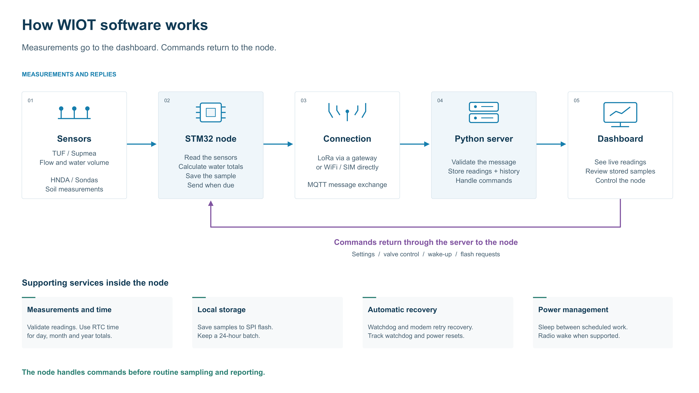

# WIOT system design and implementation

Testing and operator handover · V1.0 · 9 November 2026

WIOT collects water-flow and soil measurements from field instruments and makes them available to operators through a web dashboard. The active system combines Arduino STM32F401 firmware, an optional LoRa gateway, a Python MQTT and web server, and RS485 simulators for bench testing.

Use this report to understand how the system fits together, locate the implementation and decide what evidence is required before accepting a deployment. The companion flashing manual contains the exact board options, wiring, and step-by-step bench procedures.

| Need | Open |
| --- | --- |
| See the system in operation | Narrated WIOT system walkthrough |
| Understand the design | Sections 1–5 and STM32 Node Software Design V1.2 |
| Find the implementation | Section 3 and the source links in the handover index |
| Program a board | STM32 Flashing and Test Manual V1.0, sections 1–10 |
| Run acceptance tests | Section 6 and manual tests T01–T20 |
| Review or edit detailed flows | 30-flow HTML viewer, printable PDF and editable PowerPoint |

The active behavior is based on source revision c604aa6. The documentation baseline is e508c6f. The repository also contains separate ESP32 and STM32CubeIDE ports. Their own build instructions and feature sets apply.

## 1 System purpose and requirements

### Field operation

The node polls up to four independently configured RS485 sensors and reads the battery voltage. A single build uses direct MQTT over Wi-Fi or SIM800L, or sends to a LoRa gateway. The gateway forwards messages for several field nodes to the server, using one IP uplink.

| Requirement | Implemented behavior | Acceptance |
| --- | --- | --- |
| Measure flow and soil conditions | TUF and Supmea flow groups, HNDA and Sondas soil groups, separate enables and Modbus addresses | T05–T06 |
| Preserve trustworthy measurements | Failed groups carry invalid quality and zeros. Valid groups retain their own values. Reports continue after a completed cycle. | T06 |
| Report cumulative water use | TUF reads meter periods. Supmea derives day, month and year consumption from forward totals and trusted RTC. | T08 |
| Send status and receive commands | Company, region and node scope, with request IDs for command correlation | T02–T04, T07 |
| Retrieve recent field records | External SPI archive with a 24-hour elapsed retention generation and calendar-day history selection | T09–T10 |
| Conserve battery and recover | Configured idle or sleep, RTC wake, watchdog recovery and modem retry stages | T11–T17 |
| Actuate a commissioned valve | Timed TB6612FNG direction pulse on an eligible direct node, with commanded state reporting | T18 |

### Deployment boundary

The released firmware selects one role and one transport at build time. A sensor node may use one bus with distinct enabled slave addresses. A LoRa gateway dedicates the corresponding UART to its radio and bridges traffic without polling field instruments. The simulator replaces field Modbus slaves during bench testing.

The source tree includes the server, simulator projects and older firmware ports. Qualification in this report applies to the current Arduino STM32 deployment and its matching server and simulators.

## 2 System architecture and interfaces

Figure 1. Measurements move from the field to the dashboard. Operator commands return over the selected connection.

| Interface | Contract |
| --- | --- |
| Sensors and simulator | Modbus RTU on the sensor node's RS485 interface at 9600 8N1. Bench addresses are TUF 1, Supmea 2, HNDA 3 and Sondas 4. |
| Node and gateway | The compatible E32/AS32 radio uses framed messages, application node identities, fragment ACKs and optional WOR wake probing. |
| Direct uplink or gateway | MQTT carries encrypted protobuf frames. Use matching application keys and unique client IDs on the configured broker. |
| MQTT route and payload | wiot/{company}/{region}/{node}/status, /data and /cmd. Regional broadcast uses wiot/{company}/{region}/broadcast. |
| Server and operator | Python validates messages, stores readings and history, tracks command outcomes, and serves the dashboard on localhost port 8000 in the supplied entry point. |

The node and gateway use different radio UART allocations. Follow the profile-specific pin tables in the flashing manual, especially when moving a radio between boards.

## 3 Implementation and source map

| Component | Entry point or module | Responsibility |
| --- | --- | --- |
| Board profile | IoT_Node_Encrypted.ino and src/config/AppConfig.h | Select role, uplink, identity, sensors, power and debug. Provision private settings from templates. |
| Acquisition and scheduling | IoT_Node.cpp, FlowMeterManager.cpp, Rs485Bus.cpp, sensor drivers | Run cooperative polling, keep separate sample/report deadlines and assemble valid or unavailable fields. |
| Measurement state | SupmeaPeriodAccumulator.cpp, RTC.cpp, BatteryMonitor.cpp | Track trusted time, estimate period consumption and measure supply voltage. |
| Radio and MQTT | LoraLink.cpp, GatewayApp.cpp, MQTT.cpp | Frame or reassemble radio packets, handle fragment ACKs and forward the selected topics. |
| Command and payload | CommandHandler.cpp, PacketCodec.cpp, TelemetryPayload.cpp | Validate inputs, dispatch actions, track recent requests and encode replies. |
| Storage | S25Fl064l.cpp, TelemetryJournal.cpp, TelemetryArchive.cpp | Drive SPI NOR, recover committed samples and transfer stored history. |
| Power and recovery | PowerManager.cpp, Watchdog.cpp and reset counter modules | Enter supported idle modes, restore execution and classify reset causes. |
| Web and database | server_web.py, region_topics.py, command_queue.py, flash_archive.py | Scope messages, persist records and expose commands, outcomes and trends. |
| Simulators | Multi Sensor RS485 Simulator, TUF and Supmea simulator folders | Exercise values, addresses, timeout, CRC, exceptions and recovery. |

Find the Arduino modules under Node/IoT_Node_Encrypted/src. Use the Doxygen reference for declarations and call relationships, and the editable flowcharts for cross-component behavior.

## 4 Measurement history and command execution

### Measurement path

The scheduler completes an acquisition, assembles independent validity flags and offers the sample to the external archive when enabled. An overdue Status takes its turn before the next acquisition. Periodic Status prefers the latest committed sample and retains its acquisition timestamp. The server records receipt separately. GOSTM requests the cached measurement snapshot.

An enabled failed sensor can produce zero-valued invalid fields. Use the validity and enabled masks when judging zero readings. When all polls are disabled, periodic reporting still works after the configured cycle.

### Archive capacity and time

The S25FL064L has 8 MiB of physical capacity. The journal provides 14,322 record slots, each 512 bytes, with up to 472 bytes of stored protobuf per record. At the minimum 10-second sampling interval, one complete day produces about 8,640 samples and uses about 60 percent of the available slots before torn-record overhead.

The 24-hour expiry uses elapsed trusted time. FLASH_TODAY selects the retained portion of the current calendar day. FLASH_LAST retrieves the latest committed record. HISTORY_ACK follows server persistence. Use separate live and archive views to interpret timestamps.

### Command path

The server sends a scoped request and records its request ID. For LoRa, the gateway subscribes to the regional direct-command wildcard and broadcast topic, then forwards the applicable downlink. The addressed node validates and acts on the request. Match the application reply to the request ID before recording a successful command outcome.

| Evidence | What it confirms |
| --- | --- |
| Local publish or broker traffic | A send stage occurred |
| LoRa fragment ACK | A fragment was received by the link |
| Correlated application ACK or GOSTM reply | The node handled that request |
| History persistence ACK | The server stored the corresponding history record |

## 5 System analysis and deployment choices

| Policy | Typical use | Timing and command behavior |
| --- | --- | --- |
| NORMAL | Commissioning, gateway and continuously active nodes | Connected operation. Observe acquisition and report periods separately. |
| REMOTE_WAKE | Direct IP or normal LoRa with a reachable transport | CPU idle between scheduled work. Server commands can be serviced while the transport remains reachable. |
| LORA_WOR | Battery-operated LoRa leaf | UART RX wakes the STM32. The NORMAL gateway sends a wake probe. RTC tracks application deadlines and watchdog service. |
| POWER_DOWN | Supported Wi-Fi or LoRa scheduled Standby | RTC wake starts another cycle. A Standby leaf has a later connection window. |
| QUEUED | Supported Standby node with deferred work | The server holds eligible commands for the next connected window, subject to expiry. |

Use NORMAL to establish the signal path first. For WOR, establish RTC trust with STIME, enable gateway WOR TX, and observe wake, addressed reply, and return to Stop. The watchdog is nominally 30 seconds. An RTC heartbeat services it during WOR idle. Network recovery counts completed join failures, resets the active modem after ten, then resets the modem and controller after another ten.

| Deployment constraint | Evidence or decision needed |
| --- | --- |
| Shared LoRa channel | Measure delivery with two nodes and staggered schedules. Capture retries, timeouts and correlated request outcomes. |
| Command security | The current AES-CBC envelope provides encryption and lacks a message authentication tag. Record the deployment trust boundary and any required transport protections. |
| Sondas hardware variant | The simulator exercises the WIOT Modbus compatibility map. Confirm the purchased probe's protocol and registers. |
| Rail stability and power | Measure at a stated point, with the actual modem, converter and load. Capture the 3.3-V rail during TX if resets appear. |
| Valve allocation | PC13 is AUX in LoRa profiles. Verify the approved direct-node pinout, driver, pulse polarity and physical valve movement. |

## 6 Verification and bench acceptance

[Software verification results](VERIFICATION.md)

### Bench sequence

1. Label the target and choose one of the six build profiles in the operator manual. Compile, export, flash over SWD and check the boot identity.
2. Use NORMAL and verify Status at the server. Send GOSTM and match the request ID. For LoRa, start the connected gateway first and add the leaves separately.
3. Load the four-sensor fixture and test one device at a time. Test all four together, mute them, and confirm invalid values, continued reporting and recovery.
4. Synchronize RTC and compare the Supmea reference with equal start and end times. Verify flash commissioning, record retention, latest record and acknowledged history.
5. Test the selected power policy, then watchdog and modem recovery, voltage, commissioned valve and debug mode. Record reset causes and measurements with the setup.
6. Run the final profile for at least 48 hours, including two retention rollovers when the archive is enabled. Compare reports and command results with the recorded schedule.

Capture the firmware build and image hash, boot log, board identity, server topic and request ID, simulator configuration, relevant serial traces, and measured supply/current. Use the operator manual's reusable test-record page.

## 7 Operator documents and project handover

| Deliverable | Use |
| --- | --- |
| Project handover index | Open the video, reports, flowcharts, source entry points and operator documents together. |
| STM32 Flashing and Test Manual V1.0 | Select a profile, install tool versions, wire SWD, flash, recover and run the 20 test groups. |
| STM32 Node Software Design V1.2 | Review firmware internals, module boundaries, behavior and acceptance procedures. |
| Software Overview V2.1 | Explain the five system stages and the command return path. Edit the overview in PowerPoint. |
| Detailed flowcharts | Inspect 30 software flows in the zoomable offline viewer. Use the editable deck or printable PDF for review. |
| Release guide and Doxygen | Reproduce the software checks and locate code and APIs. |
| Narrated walkthrough | Follow the data path, command path, power behavior, flashing and bench tests. |

### Release procedure

1. Select the hardware profile and prepare its private settings locally. Match company, region, node, broker and application key across components.
2. Build the selected firmware and confirm that the image ends below the reserved EEPROM sector at 0x08020000. Record image and configuration provenance with the board.
3. Start the matching server and gateway, then deploy the nodes. Use the manual to confirm server subscriptions, boot identities, reporting and command routing.
4. Attach the measured acceptance evidence to the release record. Retain the verified image, source revision, selected profile and operator documents together.

The handover index groups files by role and task. It uses relative paths from Documentation/ProjectHandover within the final WIOT project folder.
