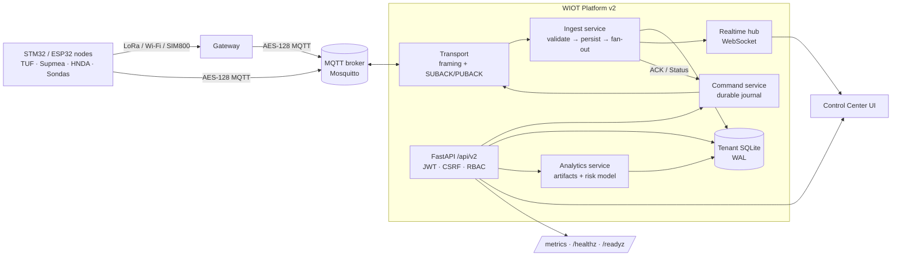

# WIOT Platform v2 — Control Center

Production-grade replacement for the v1.31 Flask server of the EgSA WIOT
water-IoT project. It ingests encrypted telemetry from the STM32 / ESP32
nodes and LoRa gateways, controls them with an audited command journal, and
ships a data-science layer (fleet analytics + a command-delivery risk model)
directly in the operator dashboard.

**Field compatibility is unchanged.** v2 uses the same MQTT topics
(`wiot/<company>/<region>/<node>/{data,status,cmd}`, `wiot/<company>/<region>/broadcast`),
the same AES-128-CBC framing (`[0x01][IV16][ciphertext]`), the same
`messages.proto`, and opens the v1.31 SQLite databases in place. No firmware
change is needed.



## What changed vs v1.31

| Area | v1.31 | v2 |
|---|---|---|
| Framework | Flask + Socket.IO, one 2,000-line file | FastAPI, layered package (`protocol`, `domain`, `storage`, `services`, `api`, `analytics`) |
| Auth | Flask session cookie | Signed JWT (cookie or `Bearer`), CSRF double-submit, revocation on password change, login throttling, password policy |
| Authorisation | username checks scattered in routes | `Principal` model (supervisor / admin / monitor / user) enforced in one dependency layer; tenant isolation tested |
| MQTT | manual connect from the UI each start | env-configured autoconnect, paho auto-reconnect, broker state pushed live |
| Realtime | Socket.IO rooms | native WebSocket, bounded per-client queues (slow browsers cannot stall ingestion) |
| Validation | partial | every request validated by pydantic; wire frames validated fail-closed before any side effect; unregistered tenants rejected |
| Observability | `system.log` | JSON rotating logs with request IDs and secret redaction, Prometheus `/metrics`, `/healthz`, `/readyz`, audit trail |
| API docs | none | OpenAPI at `/api/docs` |
| Analytics | none | analysis pipeline, delivery-risk ML model, what-if scoring, pre-send risk in the command form |
| Dashboard | single dark page | five-page control center with a **Night / Day view** toggle (header and sign-in page); follows the OS light/dark setting until chosen, remembered per browser, charts switch to a validated light palette |
| Deployment | `python server_web.py` | `python -m wiot serve`, Docker image, docker-compose with Mosquitto, systemd unit, nginx TLS proxy |
| Tests | per-module scripts | 130+ pytest checks incl. the ported v1 journal/flash regression suites; GitHub Actions CI (Ubuntu + Windows) |

## Quick start (Windows, local demo)

```powershell
cd Server\WIOT-Platform-v2
python -m venv .venv
.\.venv\Scripts\python -m pip install -e ".[analytics,dev]"
copy .env.example .env        # then set WIOT_SECRET_KEY, passwords, WIOT_MQTT_AES_KEY_HEX
.\.venv\Scripts\python -m wiot import-v1 "..\WIOT-Server-Web v1.31 - Fixed Sensor Readings in Dashboard"
.\.venv\Scripts\python -m wiot init
.\.venv\Scripts\python -m wiot serve
```

Open <http://127.0.0.1:8000>. For a self-contained demo with a local broker and
a simulated encrypted fleet, run `powershell -ExecutionPolicy Bypass -File .\run-dev.ps1`.

### Real gateways next to the demo fleet

Field gateways publish to the broker in their firmware (`kMqttServer` in
`Node/IoT_Node_Encrypted/src/config/AppConfig.cpp`, currently `broker.hivemq.com`).
A server pointed at the local `devbroker` (`WIOT_MQTT_HOST=127.0.0.1`) sees none of
that traffic unless the broker bridges it. `run-dev.ps1` therefore starts the
development broker with `--bridge broker.hivemq.com:1883 --bridge-topic wiot/Company_1/#`:
uplinks (status, data, command ACKs) are copied down, and the server's commands are
copied back up to the gateway. The simulated tenants never leave the PC. Pass
`-Bridge ""` to run offline, or more `-BridgeTopic` filters for other companies.

The server decrypts with `WIOT_MQTT_AES_KEY_HEX`, which must be the same 16 bytes as
`WIOT_AES_KEY_BYTES` in the nodes' `AppSecrets.h`. A different key makes every real
frame fail with `Invalid frame padding` and nothing appears for that company. The
simulator encrypts with whatever key the server uses, so demo tenants work with either.

In production either point `WIOT_MQTT_HOST` at the managed broker directly or bridge
with Mosquitto (`connection` + `topic wiot/# both 1`).

## CLI

| Command | Purpose |
|---|---|
| `python -m wiot serve` | API + dashboard (single worker: MQTT ingestion has one owner) |
| `python -m wiot init` | create/upgrade databases and missing built-in accounts |
| `python -m wiot import-v1 <dir>` | consistent copy of v1.31 databases (SQLite online-backup API) |
| `python -m wiot create-user <name> --role admin --company Company_1` | add an account |
| `python -m wiot reset-password <name>` | set a password and revoke that user's sessions |
| `python -m wiot check` | read-only tenant-storage preflight |
| `python -m wiot analyze` | run the analytics + ML pipeline into `data/analytics/` |
| `python -m wiot devbroker` | local development MQTT broker (amqtt) |
| `python -m wiot devbroker --bridge broker.hivemq.com --bridge-topic "wiot/Company_1/#"` | same, plus a two-way bridge so real gateways on the upstream broker appear beside the simulator |
| `python -m wiot simulate --companies Demo_Utility,Demo_AgriFarm` | encrypted virtual fleet that obeys power modes and ACKs commands only while awake |

## Configuration

All settings are environment variables with the `WIOT_` prefix (see
[.env.example](.env.example)). Important ones:

| Variable | Default | Notes |
|---|---|---|
| `WIOT_ENV` | `development` | `production` enforces a strong `WIOT_SECRET_KEY` |
| `WIOT_DATA_DIR` | `./data` | `iot_data.db`, `messages_dbs/`, `command_lifecycle.db`, `flash_archive.db` |
| `WIOT_SECRET_KEY` | random per start | signs session tokens; set it or sessions reset on restart |
| `WIOT_COOKIE_SECURE` | `false` | `true` behind HTTPS (also enables HSTS) |
| `WIOT_MQTT_AUTOCONNECT` | `false` | connect at boot using the variables below |
| `WIOT_MQTT_HOST` / `PORT` / `USERNAME` / `PASSWORD` | `broker.hivemq.com` / `1883` | shared ingestion broker |
| `WIOT_MQTT_AES_KEY_HEX` | — | 32 hex chars, identical to node/gateway `AppSecrets` |
| `WIOT_ADMIN_PASSWORD`, `WIOT_SUPERVISOR_PASSWORD`, `WIOT_MONITOR_PASSWORD` | — | only used to create missing built-in accounts |

## Security model

* **Roles** — `supervisor` (`EgSA_Supervisor`, global, owns ingestion and tenants), company
  `admin` (commands + users of its company), `monitor` / `user` (read-only; the built-in
  `Super_User` monitor may read every company, as in v1).
* **Sessions** — HS256 JWT in an `HttpOnly; SameSite=Lax` cookie (+ `Secure` under TLS) or
  an `Authorization: Bearer` header for API clients. Cookie-authenticated mutations require
  the `X-CSRF-Token` double-submit header. Password change increments `token_version`,
  revoking all earlier tokens.
* **Hardening** — strict CSP (no inline script, no CDN), `X-Frame-Options: DENY`, request
  body cap, login throttling per IP and per user, CSV formula-injection neutralisation,
  secrets redacted from logs, audit trail of every privileged action.
* **Wire** — topic/payload node cross-check, protobuf size bounds, enum range checks and
  finite-number checks run before storage, live fan-out, ACK handling or queue release.

## Documentation

**Developers and agents start with [`docs/HANDOFF.md`](docs/HANDOFF.md)** (rules, architecture, run / test / commit,
domain facts, open issues, roadmap), then [`docs/CHANGELOG.md`](docs/CHANGELOG.md) (everything done, by date) and the
generated references in [`docs/reference/`](docs/reference) (API, configuration, CLI, database schemas, code map,
tests, events and metrics; regenerate with `.venv\Scripts\python docs\tools\gen_reference.py`).

The release documents live in `Documentation/ServerSoftware/` (Word + PDF, built from the
Markdown sources there with `python build_docs.py`, which drives Microsoft Word):

| Document | Contents |
|---|---|
| `WIOT_Control_Center_User_Manual_V1.0` | Every page and everyday task, with screenshots; Arabic quick guide |
| `WIOT_Server_v2_System_Analysis_and_Design_V1.0` | Requirements, architecture, protocol, data, interfaces, security, design decisions |
| `WIOT_Server_v2_Test_Report_V1.0` | Automated, UI and live-hardware test results, defects and open issues |

Server flowcharts F31 onward are part of `Documentation/Flowcharts/WIOT_Project_Flowcharts.html`.

## API (excerpt — full schema at `/api/docs`)

| Method | Path | |
|---|---|---|
| POST | `/api/v2/auth/login` · `/logout` · `/password`, GET `/auth/me` | sessions |
| GET | `/api/v2/fleet` | latest reading + link state per node |
| GET | `/api/v2/nodes/{id}`, `/nodes/{id}/series?metric=flow&hours=24` | node detail, bucketed time series (mean/min/max) |
| GET | `/api/v2/messages`, `/consumption`, `/export.csv` | history, period volumes, streaming CSV |
| POST/GET | `/api/v2/commands`, `/commands/{request_id}` | submit (now / next wake), lifecycle with events, receipts and attempts |
| POST | `/api/v2/commands/risk` | probability the node will acknowledge a command right now (+ SHAP drivers) |
| GET | `/api/v2/analytics/{summary,link,power,sensors,commands,model,firmware,project}` | analysis artifacts |
| POST | `/api/v2/analytics/predict` | what-if scoring on edited model inputs |
| GET/POST | `/api/v2/broker`, `/broker/connect`, `/broker/disconnect` | ingestion control |
| GET | `/api/v2/flash/status`, `/flash/records` (`format=csv`), `/flash/nodes`, `/flash/analysis`, `/flash/lock` | node flash log: memory, downloaded samples, analysis, what blocks a new flash command |
| GET · POST | `/api/v2/alerts?status=open\|all`, `/alerts/{id}/acknowledge` | persistent fleet alerts and their summary |
| WS | `/api/v2/ws` | `telemetry`, `command`, `flash`, `alert`, `log`, `broker` events |
| GET | `/healthz`, `/readyz`, `/metrics` | probes and Prometheus metrics |

## Flash data (node SPI-flash log)

Each node keeps a 24-hour telemetry log on its 8 MB SPI flash (14,322 × 512 B record slots;
the log clears and starts a new *generation* every 24 elapsed hours). The **Flash data** page
(Insights → Flash data) drives it with the flash commands and analyses what comes back:

- **Read status** (`FLASH_STATUS`): chip state, JEDEC ID, record and byte accounting, erase
  progress, RTC trust and the retention window. The page projects the fill rate to the next clear
  and warns when the record limit would be reached first.
- **Download today** (`FLASH_TODAY`), **Latest sample** (`FLASH_LAST`), **Cancel download**,
  **Erase log** (`CLEAR_FLASH`, confirmed). Rows are acknowledged only after the SQLite commit
  (`flash_archive.db`), and the page refreshes live on every `flash` event.
- **Logging quality**: samples stored vs not logged (clock untrusted, window not started, write
  queue busy, log full).
- **Gap recovery**: each archived sample is matched against the node's live uplinks
  (±2 × transmission interval, at least 60 s). Samples with no live counterpart were taken while the
  radio link was silent, so they are data the server has only because of the flash log.
- **Coverage per generation** (sequence gaps, completeness, spacing, how many records on the node
  are not yet downloaded), download progress and outcome (complete / stopped / stalled), valid-only
  statistics and charts per measurement, the paged record table, and a CSV export.
- **One flash conversation per node.** While a history download is running, or a flash command is
  still waiting for the node's reply (or queued for its next wake), the server refuses every other
  flash command for that node with **409** and says what it is waiting for; **Cancel download** is
  always accepted. Extra downlinks during a download collide with its per-row ACKs on the LoRa link.
  A download counts as running until it ends, or until 6 minutes pass without a message from it
  (the node retries a record 3 × 60 s, then its end message 3 × 60 s, before going idle). The page
  shows a *Node busy* strip and disables the other buttons until the lock clears.

## Smart agriculture & irrigation

The landing page is a **satellite farm map** (Leaflet, served locally) for precision irrigation:

* **Irrigation zones** — centre pivots (circle) or polygons, each bound to a node. Fields are
  coloured by soil moisture against the crop's target band (or by salinity/EC, soil temperature,
  irrigation state); irrigating pivots show a turning arm. Soil probes, the LoRa gateway and its
  live links are drawn on the map.
* **Zone panel** — moisture gauge and target band, EC, soil temperature, flow, water applied
  today, crop ET (ET₀ × FAO-56 Kc), valve state with **Start / Stop irrigation** (sent through the
  audited command journal; sleeping nodes get *next-wake* delivery) and a 24 h history.
* **Advisory** — soil-water deficit to the band midpoint over the root zone, converted to runtime
  with the application rate; holds irrigation when forecast rain covers the deficit.
* **Automation** (opt-in per zone) — hysteresis control on every fresh Status: below the band →
  `VALVE 1`, above → `VALVE 0`, rate-limited, logged, pushed live and written to the audit trail.
* **Weather & ET₀** — Open-Meteo 7-day forecast and FAO-56 reference evapotranspiration for the
  farm centre (only the coordinates are sent; disable with `WIOT_WEATHER_ENABLED=false`).
* **Satellite backhaul readiness** — LoRa → gateway → cellular / satellite topology, measured
  AES frame sizes per node (1 B version + 16 B IV + padded protobuf), reports/day against a
  satellite message budget, and a checklist of the store-and-forward / sleep-aware features that
  let the same firmware move to satellite IoT.

The demo tenant **Demo_AgriFarm** is seeded with six real centre pivots in **East Owainat**
(Egypt's Western Desert, ≈46 ha each) located by circle detection on the imagery; run the
simulator to see the soil-water balance, automation and alerts live. Other tenants get a layout
via `PUT /api/v2/farm/layout` (format: [`wiot/data/demo_farm_layout.json`](wiot/data/demo_farm_layout.json))
or the JSON editor shown on their Farm page; admins can drag probes/gateways and save.

| Method | Path | |
|---|---|---|
| GET | `/api/v2/farm/overview` | zones with live status/advice, KPIs, alerts, weather |
| GET/PUT | `/api/v2/farm/layout` | farm geometry (validated) |
| PATCH | `/api/v2/farm/zones/{id}` | target band, crop, automation flag |
| GET | `/api/v2/farm/zones/{id}/history` | moisture, flow, soil temp, EC series |
| GET | `/api/v2/farm/weather`, `/api/v2/farm/connectivity?budget=48` | forecast/ET₀; satellite sizing |

Imagery defaults to Esri World Imagery with attribution; review the provider's terms for your
deployment or point `WIOT_MAP_TILE_URL` at another XYZ source (e.g. your own tile server).

## Organization & global operation

**Organization page** (`#/org`) — manage the whole deployment from the UI:

| Tab | What you can do | Who |
|---|---|---|
| Companies | create, edit profile (display name, country, time zone, units, default language, HQ location), archive / restore, strict provisioning | create/archive: supervisor · edit own profile: company admin |
| Regions | register regions with name, country, time zone and coordinates; regions seen in telemetry are listed as *discovered* | company admin |
| Nodes | register as **Monitoring** (sensors only) or **Control** (sensors + valve) with the sensors fitted (HNDA soil, Sondas EC, TUF / Supmea flow); edit, move between regions, unregister; CSV import/export; nodes seen in telemetry but not registered are listed with a *Register* button and their detected sensors | company admin |
| Gateways | gateway inventory with backhaul links (LoRa, Wi-Fi, cellular, satellite, Ethernet) and primary link | company admin |
| API & webhooks | API tokens and signed webhooks | company admin (human sessions only) |

**Node types** — a *monitoring node* only reports sensor readings; a *control node* also drives a
valve. Valve (actuation) commands to a registered monitoring node are refused with HTTP 409 — from
the Command center, the farm page's Start/Stop buttons and automatic irrigation alike — and the
farm page shows such fields as monitored-only. Unregistered nodes keep the previous behaviour.
Sensors are detected from each node's `sensor_mask` (bits: 1 TUF, 2 HNDA, 4 Sondas, 8 Supmea).

Company and region IDs are part of the MQTT topic and cannot be renamed; display names can.
Archiving a company stops ingestion and hides it while keeping its data. With **strict
provisioning** on, telemetry from unregistered nodes is rejected (`wiot_messages_dropped_total{reason="unregistered_node"}`).

**World operations** (`#/world`) — every company's sites on one map, coloured by live node
status, with each company's local time, countries, time zones and uplinks. Sites are placed from
region coordinates, else the farm layout, else the company headquarters.

**Language, time zone, units** — the interface is available in English and Arabic (right-to-left)
from the *Language* switch on the top bar and the sign-in page; dictionaries live in
`wiot/web/assets/i18n.js`. Times are shown in the selected company's time zone, and daily /
monthly flow totals are bucketed in that time zone. Each company can use metric or imperial
(US gal, gpm, acres, °F, inches) units; values are stored in SI and converted for display.

**API tokens** — `Authorization: Bearer wiot_…` on any `/api/v2` endpoint (no cookie or CSRF).
Tokens are scoped to one company, *read* or *read & write*, optionally expiring, shown once and
stored as SHA-256 hashes. A token can never manage users, tokens or webhooks.

**Webhooks** — HTTPS POST of `{id, event, company, ts, data}` for `telemetry`, `command`,
`automation`, `alert` and `flash` events, retried up to 3 times on worker threads. Verify each
delivery: `X-WIOT-Signature == "sha256=" + HMAC_SHA256(secret, raw_body)`. `alert` events are
sent once when an alert opens (`node_offline`, `low_battery`, `flow_unstable`) and once when it
clears (`node_online`, `low_battery_resolved`, `flow_unstable_resolved`); see *Alerts* below.
Private and loopback destinations are refused unless `WIOT_WEBHOOK_ALLOW_PRIVATE=true` (default:
allowed only in development).

| Method | Path | Purpose |
|---|---|---|
| GET/POST/PATCH | `/api/v2/org/companies[/{name}]` | company profiles |
| GET/POST/PATCH/DELETE | `/api/v2/org/regions[/{region}]` | regions (+ discovered) |
| GET/POST/PATCH/DELETE | `/api/v2/org/nodes[/{region}/{node_id}]` | node registry (+ discovered) |
| POST · GET | `/api/v2/org/nodes/import` · `/api/v2/org/nodes/export.csv` | bulk CSV |
| GET/POST/PATCH/DELETE | `/api/v2/org/gateways[/{gw_id}]` | gateways |
| GET/POST/DELETE | `/api/v2/org/tokens[/{id}]` | API tokens |
| GET/POST/PATCH/DELETE | `/api/v2/org/webhooks[/{id}]`, `…/{id}/test`, `…/{id}/rotate`, `…/{id}/deliveries` | webhooks |
| GET | `/api/v2/org/world` | world view data |

## Alerts

The fleet monitor (`WIOT_ALERT_MONITOR`, default on) checks every node of every company once a
minute and keeps **persistent alerts** in `iot_data.db`: at most one open alert per node and kind.
An alert opens when its condition is first seen and resolves when it clears, so a condition that
lasts for days, or survives a server restart, is reported once, and a node that is already silent
when the server starts is reported too.

| Kind | Severity | Opens when | Clears when |
|---|---|---|---|
| `node_offline` | critical | no uplink for 6 × the node's usual report interval | the node reports again |
| `low_battery` | warning | battery below 3.3 V while reporting | battery ≥ 3.4 V |
| `flow_unstable` | warning | within one hour, the flow reading jumps ×5 or more (both readings ≥ 1) at least 3 times and changes direction at least twice | a full hour of readings with no such jump |

Pump starts and stops are one-way steps and do not trigger `flow_unstable`; real pipe flow does not
oscillate by ×8 between uplinks, so the cause is the meter, its wiring or Modbus settings, or a
simulator on the RS-485 port. The **Alerts** page (Operations → Alerts) lists open alerts and the
last 7 days, and the sidebar shows the number of open alerts nobody has acknowledged yet.
Operators (command privilege) can acknowledge an alert; it stays open until its condition clears.

## Analytics

`python -m wiot analyze` reads the databases read-only and writes JSON
artifacts, figures, a trained model and `REPORT.md` to `data/analytics/`. The
dashboard's **Data science** page renders them; supervisors can re-run the
pipeline from the UI. See `data/analytics/REPORT.md` for the full write-up.

## Operations

* **Backups** — copy `data/` with the SQLite online-backup API (`python -m wiot import-v1`
  uses it) or snapshot the volume; databases run in WAL mode.
* **Logs** — `data/logs/wiot-server.log` (JSON, rotated 10 MB × 5).
* **Monitoring** — scrape `/metrics`: `wiot_messages_ingested_total`, `wiot_messages_dropped_total{reason}`,
  `wiot_command_receipts_total`, `wiot_broker_ready`, `wiot_ingest_seconds`, HTTP latency.
* **Docker** — `docker compose up -d --build` starts Mosquitto and the platform.

## Tests

```powershell
.\.venv\Scripts\python -m pytest
```

In the EgSA_IOT repository, `.github/workflows/server-v2-tests.yml` runs the same suite on every
push or pull request that touches `Server/WIOT-Platform-v2/`: Ubuntu with Python 3.12 (the Docker
image) and Windows with Python 3.14 (the development PC). Tests that need the live databases skip
themselves there, because `data/` is never committed.
